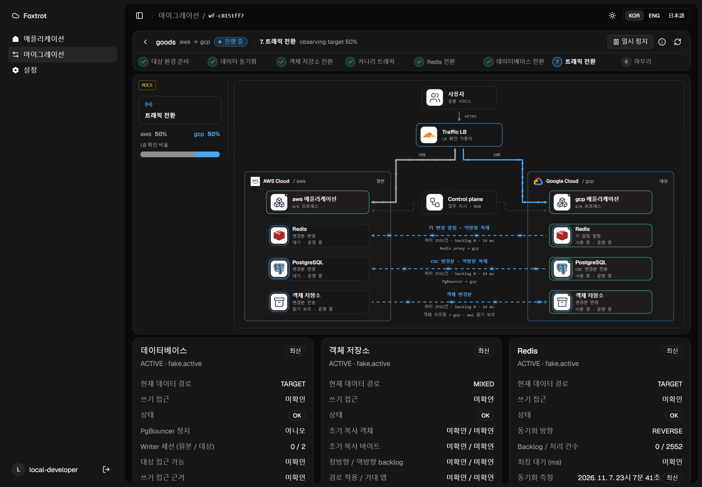
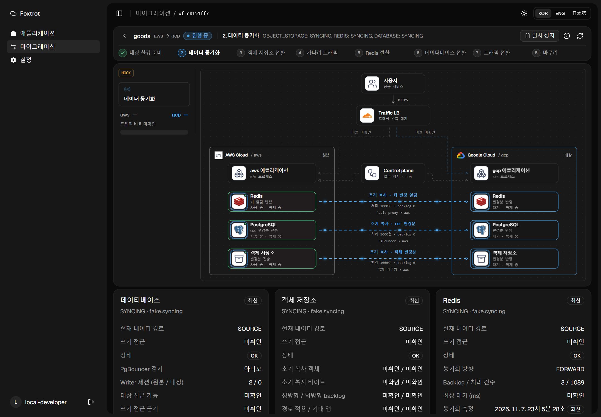
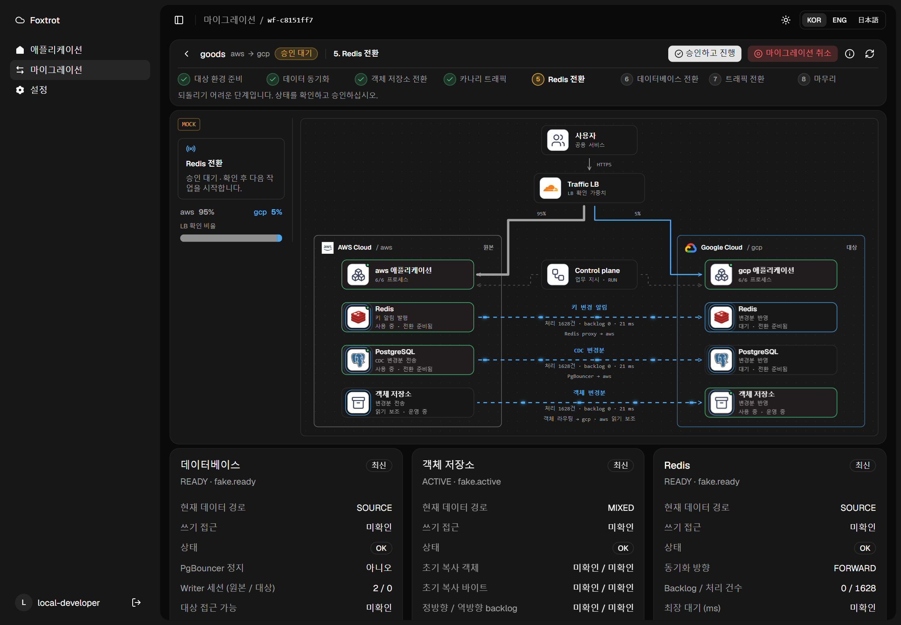
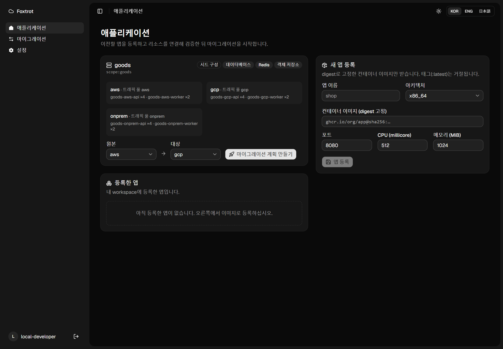
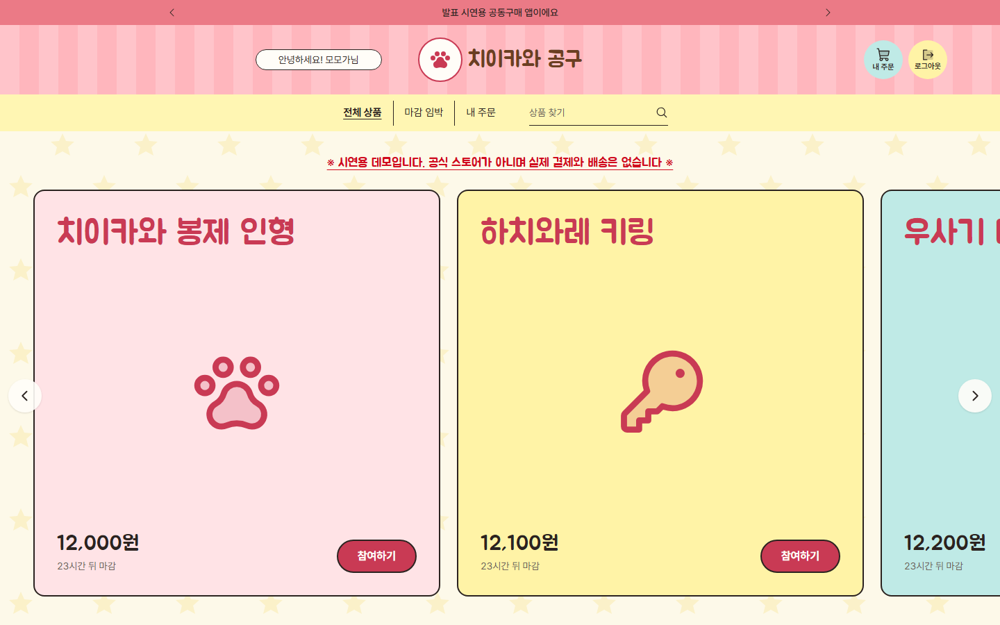

  

  <b>Team Foxtrot</b> · SoftBank Hackathon 2026 본선 ·
  <a href="#구조">구조</a> ·
  <a href="#이전-과정">이전 과정</a> ·
  <a href="#파트별-설계">파트별 설계</a> ·
  <a href="#팀">팀</a>

## Foxtrot은

실행 중인 앱의 **데이터베이스, Redis, 객체 저장소, 트래픽**을 AWS · Google Cloud · 온프레미스 사이에서 옮기는 멀티클라우드 마이그레이션 플랫폼입니다.

앱은 고정 주소(Redis 프록시, PgBouncer, 객체 라우팅)만 압니다. 플랫폼은 그 뒤의 실제 위치를 정해진 순서로 바꿉니다. 먼저 복사하고 변경분을 계속 따라잡은 뒤, 리소스를 하나씩 전환하고, 트래픽을 단계적으로 옮깁니다. 되돌리기 어려운 단계마다 사람이 승인하고, 문제가 생기면 리소스 단위로 되돌립니다.

  
   트래픽 전환 중인 콘솔. DB와 Redis는 이미 대상에서 운영하고, 되돌릴 수 있도록 원본으로 역방향 복제합니다. (로컬 시뮬레이션 · 화면에 MOCK 표시)

## 구조

<picture>
  <source media="(prefers-color-scheme: dark)" srcset="https://raw.githubusercontent.com/SoftBank-2026-Hackathon-Foxtrot/.github/main/profile/assets/architecture-dark.png">
  
</picture>

| 층 | 구성 | 역할 |
|---|---|---|
| 진입점 | Cloudflare Load Balancer | 사용자 주소는 그대로 두고 원본·대상 pool의 가중치만 바꿉니다. 적용한 값을 다시 읽어 확인합니다. |
| 실행 환경 | AWS EC2 · Google Compute Engine | 같은 이미지의 앱이 양쪽에서 뜹니다. 대상 환경은 Terraform으로 만듭니다. |
| 고정 주소 | Redis 프록시 · PgBouncer · 객체 라우팅 | 앱은 이 주소만 압니다. 전환 때 바뀌는 것은 그 뒤의 실제 저장소입니다. |
| 데이터 | ElastiCache ↔ Memorystore · RDS ↔ Cloud SQL · S3 ↔ Cloud Storage | 초기 복사 뒤 변경분을 계속 반영하고, 전환 뒤에는 되돌림에 대비해 역방향으로 복제합니다. |
| 관리 평면 | control-plane · 이전 어댑터 · 콘솔 | 단계마다 한 가지를 수행하고 기록합니다. 어댑터는 모두 같은 마이그레이션 API를 따릅니다. |

온프레미스(Valkey · SeaweedFS)도 같은 어댑터와 같은 순서로 옮깁니다.

## 이전 과정

| 단계 | 하는 일 | 사람의 승인 |
|---|---|---|
| 1. 대상 환경 준비 | 대상 클라우드에 인프라와 앱을 준비합니다. | 계획 승인 |
| 2. 데이터 동기화 | DB · Redis · 객체 저장소를 초기 복사하고 변경분을 계속 반영합니다. | |
| 3. 객체 저장소 전환 | 쓰기를 대상 버킷으로 옮깁니다. 마무리 전까지 원본은 읽기 보조로 남습니다. | |
| 4. 카나리 트래픽 | 트래픽 일부를 대상으로 보내고 실제 업무 경로를 검사합니다. | |
| 5. Redis 전환 | 쓰기를 잠깐 멈추고 프록시의 대상을 바꿉니다. Pub/Sub 구독은 끊기지 않습니다. | 필요 |
| 6. 데이터베이스 전환 | 앱의 업무 정지를 확인하고, 마지막 변경분까지 맞춘 뒤 PgBouncer 경로를 바꿉니다. | 필요 |
| 7. 트래픽 전환 | 가중치를 단계적으로 올리고 단계마다 결과를 확인합니다. | |
| 8. 마무리 | 원본 읽기와 복제를 정리합니다. | 필요 |

진행 중에는 일시 정지, 재개, 상태 대조(RECONCILE), 리소스별 되돌리기, 취소를 할 수 있습니다. 결과가 불명확하면 대조가 끝날 때까지 다음 변경을 보내지 않습니다.

<table>
  <tr>
    <td width="50%"></td>
    <td width="50%"></td>
  </tr>
  <tr>
    <td><b>2. 데이터 동기화</b> · 초기 복사와 함께 Redis 키 변경 알림, DB CDC, 객체 변경 이벤트를 따로 보여줍니다.</td>
    <td><b>5. Redis 전환 승인 대기</b> · 객체 저장소는 이미 대상에서 쓰고, 원본은 읽기 보조로 남아 있습니다.</td>
  </tr>
  <tr>
    <td></td>
    <td></td>
  </tr>
  <tr>
    <td><b>애플리케이션</b> · digest로 고정한 이미지로 앱을 등록하고, 원본과 대상을 골라 계획을 만듭니다.</td>
    <td><b>이전 대상 앱</b> · 로그인, 공동구매 주문, 영수증, Redis Pub/Sub 실시간 채팅이 있는 치이카와 공구앱입니다.</td>
  </tr>
</table>

콘솔 화면은 실제 control-plane 코드에 가짜 어댑터를 연결한 로컬 시뮬레이션입니다. 화면의 MOCK 표시는 합성 수치라는 뜻입니다.

## 파트별 설계

### control-plane · 오케스트레이터
[control-plane](https://github.com/SoftBank-2026-Hackathon-Foxtrot/control-plane)

- 엔진은 상태를 메모리에 두지 않습니다. 틱마다 저장소에서 읽고 한 가지를 수행한 뒤 저장하므로, 프로세스가 죽어도 이어서 진행합니다.
- 외부 변경 전에 의도와 멱등 키를 먼저 기록합니다. 응답을 잃으면 같은 키로 원래 작업을 찾습니다.
- 리소스마다 다른 점은 프로필 한 곳에만 둡니다. 엔진에는 리소스별 분기가 없습니다.
- GitHub 로그인과 세션, CSRF, 소유자별 앱·워크플로를 제공합니다.

### db-migration-adaptor · PostgreSQL
[db-migration-adaptor](https://github.com/SoftBank-2026-Hackathon-Foxtrot/db-migration-adaptor)

- RDS PostgreSQL 17 → Cloud SQL PostgreSQL 17 논리 복제(초기 복사 + CDC)입니다. 사업자의 DMS 작업에 묶이지 않습니다.
- 전환 순서: 업무 정지 근거 → PgBouncer PAUSE → writer 차단 → 최종 LSN 확인 → 구독 정지 → 시퀀스 맞춤 → 경로 변경.
- 결과가 불명확하면 UNKNOWN에서 멈추고 실제 클라우드 실행 ID와 대조합니다.

### redis-migrator · Redis
[redis-migrator](https://github.com/SoftBank-2026-Hackathon-Foxtrot/redis-migrator)

- 앱은 Go로 만든 RESP 프록시만 압니다. 전환 때 쓰기를 잠깐 멈추고 프록시의 대상을 바꿉니다.
- Sync Worker가 원본의 keyspace 알림을 구독하고, 바뀐 키를 다시 읽어 대상에 반영합니다. 알림은 계기이고 데이터는 다시 읽어서 옮깁니다.
- Pub/Sub 구독은 전환해도 연결이 유지됩니다. 작업 큐는 복사하지 않고 원본을 다 소비한 뒤 소비자를 옮깁니다.

### object-migration · 객체 저장소
[object-migration](https://github.com/SoftBank-2026-Hackathon-Foxtrot/object-migration)

- S3 · Cloud Storage · SeaweedFS 사이를 rclone과 변경 이벤트(SQS · Pub/Sub · filer 구독)로 맞춥니다.
- 전환은 두 단계입니다. 먼저 읽기가 두 버킷을 함께 보고, 모든 앱이 적용하면 쓰기를 대상으로 옮깁니다.
- 되돌림에 대비해 대상에 새로 쓴 객체를 원본으로도 복사합니다.

### traffic · 진입점
[traffic](https://github.com/SoftBank-2026-Hackathon-Foxtrot/traffic)

- Cloudflare Load Balancer의 pool 가중치를 바꾸고, 설정을 다시 읽어 실제로 적용됐는지 확인합니다.
- revision과 멱등 키로 동시 변경과 응답 유실을 막습니다. UNKNOWN이면 다음 변경을 멈춥니다.
- 클라우드 사이는 Tailscale 사설망으로 연결합니다.

### IaC · 환경
[IaC](https://github.com/SoftBank-2026-Hackathon-Foxtrot/IaC)

- 원본과 대상 환경(네트워크, RDS · Cloud SQL, ElastiCache · Memorystore, S3 · Cloud Storage, 앱 서버)을 Terraform으로 만듭니다.
- 레지스트리 이미지로 실행 중인 앱까지 띄우며, plan을 확인한 뒤 같은 saved plan을 실행합니다.

### platform-frontend · 콘솔
[platform-frontend](https://github.com/SoftBank-2026-Hackathon-Foxtrot/platform-frontend)

- React · TypeScript · TanStack Query · shadcn/ui, Feature-Sliced Design 구조입니다.
- 전환 구성도는 백엔드가 보고한 값만 그립니다. 측정되지 않은 값은 0이 아니라 미확인으로 표시합니다.
- 응답은 런타임 스키마로 검증하고, 명령은 멱등 키와 기대 버전을 함께 보냅니다.

### demo · 이전 대상 앱
[demo](https://github.com/SoftBank-2026-Hackathon-Foxtrot/demo)

- FastAPI와 React로 만든 라이브 공동구매 앱입니다. 세션 · 캐시 · 큐는 Redis, 주문과 채팅은 PostgreSQL, 영수증은 객체 저장소에 둡니다.
- control-plane의 업무 정지 지시를 따르고, 화면에서 어느 환경이 요청을 처리했는지 보여줍니다.

## 검증 기록

| 대상 | 결과 | 기록 |
|---|---|---|
| 객체 저장소 | 7개 방향(롤백 포함) 전환 중 실패 요청 0건, 서버 강제 종료 후 재시작에도 누락 0건 | [object-migration](https://github.com/SoftBank-2026-Hackathon-Foxtrot/object-migration#status) |
| 트래픽 | 전환·비율 유지 실험에서 HTTP 13,000건 중 실패 0건 | [traffic](https://github.com/SoftBank-2026-Hackathon-Foxtrot/traffic/blob/main/docs/traffic-verification-20261105.md) |
| 컴퓨트 | EC2 → GCE 전환·롤백 리허설에서 세션 요청 291건 성공 | [IaC](https://github.com/SoftBank-2026-Hackathon-Foxtrot/IaC/blob/main/docs/compute-cloud-rehearsal.md) |

수치는 각 저장소에 기록된 실험 범위의 결과입니다.

## 팀

<table>
  <tr>
    <td align="center"><a href="https://github.com/hyunsuhahaha"> <b>hyunsuhahaha</b></a> 플랫폼 백엔드 · 콘솔 Redis · demo</td>
    <td align="center"><a href="https://github.com/noeulnight"> <b>noeulnight</b></a> DB 마이그레이션 콘솔 API</td>
    <td align="center"><a href="https://github.com/yyoungjin"> <b>yyoungjin</b></a> 객체 저장소 IaC</td>
    <td align="center"><a href="https://github.com/dlacowns21"> <b>dlacowns21</b></a> 트래픽 계층</td>
    <td align="center"><a href="https://github.com/SuperSon7"> <b>SuperSon7</b></a> IaC · 배포 모니터링</td>
  </tr>
</table>

## 저장소

| 저장소 | 내용 |
|---|---|
| [control-plane](https://github.com/SoftBank-2026-Hackathon-Foxtrot/control-plane) | 오케스트레이터와 콘솔 API |
| [platform-frontend](https://github.com/SoftBank-2026-Hackathon-Foxtrot/platform-frontend) | 플랫폼 콘솔 |
| [db-migration-adaptor](https://github.com/SoftBank-2026-Hackathon-Foxtrot/db-migration-adaptor) | PostgreSQL 논리 복제 · PgBouncer |
| [redis-migrator](https://github.com/SoftBank-2026-Hackathon-Foxtrot/redis-migrator) | Redis 프록시 · Sync Worker |
| [object-migration](https://github.com/SoftBank-2026-Hackathon-Foxtrot/object-migration) | S3 · Cloud Storage · SeaweedFS |
| [traffic](https://github.com/SoftBank-2026-Hackathon-Foxtrot/traffic) | Cloudflare 가중치 · Tailscale |
| [IaC](https://github.com/SoftBank-2026-Hackathon-Foxtrot/IaC) | Terraform · 앱 환경 프로비저닝 |
| [demo](https://github.com/SoftBank-2026-Hackathon-Foxtrot/demo) | 이전 대상 앱 |
| [design-docs](https://softbank-2026-hackathon-foxtrot.github.io/design-docs/architecture/) | 설계 도식 |

`develop`에서 통합하고, 발표·배포 단위로 `release/N`을 만듭니다.
