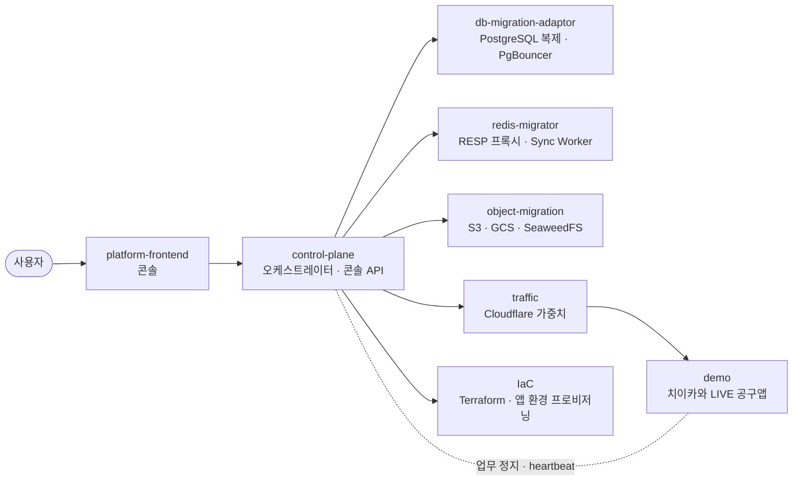

# Foxtrot — Beyond Lock-In

**실행 중인 앱을 AWS · GCP · 온프레미스 사이에서 멈추지 않고 옮기는 멀티클라우드 마이그레이션 플랫폼**

SoftBank Hackathon 2026 본선 · Team Foxtrot

Foxtrot은 앱의 데이터베이스, Redis, 객체 저장소와 트래픽을 정해진 순서로 옮깁니다. 위험한 단계마다 사람이 승인하고, 문제가 생기면 리소스 단위로 되돌립니다. 결과를 모르면 추측하지 않고 멈춥니다.

## 구성

앱은 고정 주소(Redis 프록시, PgBouncer, 객체 저장소 라우팅)만 압니다. 전환할 때 바뀌는 것은 그 뒤의 실제 위치입니다.

## 저장소

| 저장소 | 역할 |
|---|---|
| [control-plane](https://github.com/SoftBank-2026-Hackathon-Foxtrot/control-plane) | 플랫폼 백엔드. 이전 서버와 트래픽 서비스를 정해진 순서로 제어하고 콘솔 API를 제공합니다. |
| [platform-frontend](https://github.com/SoftBank-2026-Hackathon-Foxtrot/platform-frontend) | 플랫폼 콘솔. 앱 등록, 마이그레이션 계획·승인·롤백, 전환 구성도와 관측 화면입니다. |
| [db-migration-adaptor](https://github.com/SoftBank-2026-Hackathon-Foxtrot/db-migration-adaptor) | RDS PostgreSQL → Cloud SQL 논리 복제(초기 복사 + CDC)와 PgBouncer 경로 전환입니다. |
| [redis-migrator](https://github.com/SoftBank-2026-Hackathon-Foxtrot/redis-migrator) | Redis 프록시와 Sync Worker. keyspace 알림으로 변경 키를 다시 읽어 복제하고, 전환 중에도 Pub/Sub 구독을 유지합니다. |
| [object-migration](https://github.com/SoftBank-2026-Hackathon-Foxtrot/object-migration) | S3 · GCS · SeaweedFS 사이 객체 이전. 변경 이벤트를 따라 맞추고, 앱은 전환 중 두 버킷을 함께 읽습니다. |
| [traffic](https://github.com/SoftBank-2026-Hackathon-Foxtrot/traffic) | Cloudflare Load Balancer 가중치 조절과 결과 재확인, Tailscale 사설망입니다. |
| [IaC](https://github.com/SoftBank-2026-Hackathon-Foxtrot/IaC) | AWS · GCP 원본과 대상 환경을 Terraform으로 만들고, 실행 중인 앱까지 프로비저닝합니다. |
| [demo](https://github.com/SoftBank-2026-Hackathon-Foxtrot/demo) | 이전 대상 앱. 로그인, 공구 주문, 영수증, Redis Pub/Sub 실시간 채팅이 있습니다. |
| [design-docs](https://softbank-2026-hackathon-foxtrot.github.io/design-docs/architecture/) | 전체 구조와 단계별 설계 도식입니다. |

## 이전 순서

| 단계 | 하는 일 |
|---|---|
| 1. 대상 환경 준비 | 대상 클라우드에 인프라와 앱을 준비합니다. |
| 2. 데이터 동기화 | DB · Redis · 객체 저장소의 초기 복사 후 변경분을 계속 반영합니다. |
| 3. 객체 저장소 전환 | 쓰기를 대상 버킷으로 옮깁니다. 마무리 전까지 원본은 읽기 보조로 남습니다. |
| 4. 카나리 트래픽 | 일부 트래픽을 대상으로 보내고 실제 업무 경로를 검사합니다. |
| 5. Redis 전환 | 쓰기를 잠깐 멈추고 프록시의 대상을 바꿉니다. |
| 6. 데이터베이스 전환 | 앱 업무 정지를 확인하고 최종 변경분까지 맞춘 뒤 경로를 바꿉니다. |
| 7. 트래픽 전환 | 가중치를 단계적으로 올리며 매 단계를 확인합니다. |
| 8. 마무리 | 원본 읽기·복제를 정리합니다. |

되돌리기 어려운 단계는 승인 전까지 진행하지 않습니다. 진행 중에는 일시 정지, 재개, 상태 대조, 리소스별 되돌리기, 취소를 할 수 있습니다.

## 설계 원칙

- **상태는 저장소에만 둡니다.** 엔진은 틱마다 읽고 한 가지를 수행한 뒤 저장합니다. 프로세스가 죽어도 이어서 진행합니다.
- **외부 변경 전에 의도를 먼저 기록합니다.** 모든 명령은 멱등 키를 가지며, 응답을 잃으면 같은 키로 원래 작업을 찾습니다.
- **모르면 멈춥니다.** 결과가 불명확하면 대조(RECONCILE) 전까지 다음 변경을 보내지 않습니다.
- **리소스별 차이는 한 곳에 둡니다.** 공통 마이그레이션 API를 따르고, 리소스마다 다른 점은 프로필에만 있습니다.

## 검증 기록

| 대상 | 결과 | 출처 |
|---|---|---|
| 객체 저장소 | 7개 방향, 롤백 포함 전환 중 실패 요청 0건 | [object-migration](https://github.com/SoftBank-2026-Hackathon-Foxtrot/object-migration#status) |
| 트래픽 | 전환·비율 유지 실험에서 HTTP 13,000건 중 실패 0건 | [traffic](https://github.com/SoftBank-2026-Hackathon-Foxtrot/traffic/blob/main/docs/traffic-verification-20261105.md) |
| 컴퓨트 | EC2 → GCE 전환·롤백에서 세션 요청 291건 성공 | [IaC](https://github.com/SoftBank-2026-Hackathon-Foxtrot/IaC/blob/main/docs/compute-cloud-rehearsal.md) |

수치는 각 저장소에 기록된 실험 범위의 결과입니다.

## 브랜치

`develop`에서 통합하고, 발표·배포 단위로 `release/N`을 만듭니다.
