

  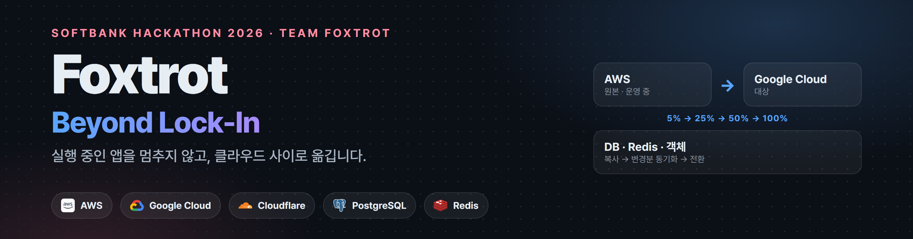

  <b>Team Foxtrot</b> · SoftBank Hackathon 2026 in Korea 본선 
  <a href="#한국어">한국어</a> · <a href="#日本語">日本語</a>

---

## Foxtrot은

**실행 중인 앱의 데이터베이스, Redis, 객체 저장소, 트래픽을 AWS · Google Cloud · 온프레미스 사이에서 옮기는 플랫폼**입니다.

앱은 고정 주소만 압니다. Redis 프록시, PgBouncer, 객체 라우팅이 그 주소입니다. 플랫폼은 그 뒤의 실제 저장소를 정해진 순서로 바꿉니다. 먼저 복사하고, 변경분을 계속 따라잡고, 리소스를 하나씩 전환하고, 트래픽을 단계적으로 옮깁니다. 되돌리기 어려운 단계마다 사람이 승인하고, 문제가 생기면 리소스 단위로 되돌립니다.

**실제 클라우드에서 잰 결과** · 계층별 측정입니다.

| 계층 | 경로 | 결과 |
|---|---|---|
| PostgreSQL | RDS → Cloud SQL, 주문 5만 건 | 쓰기 정지 **2.82초**, 쓰기 오류 **0건** |
| Redis | ElastiCache ↔ Memorystore, 키 30만 개 | 전환·롤백 쓰기 정지 **46~61ms**, 요청 실패 **0건** |
| 객체 저장소 | S3 · Cloud Storage · SeaweedFS 7개 방향 | 롤백 포함 요청 실패 **0건** |
| 트래픽 | EC2 ↔ GCE, 100:0 → 95:5 → 50:50 → 0:100 → 롤백 | 연속 요청 3,000건 중 실패 **0건** |

  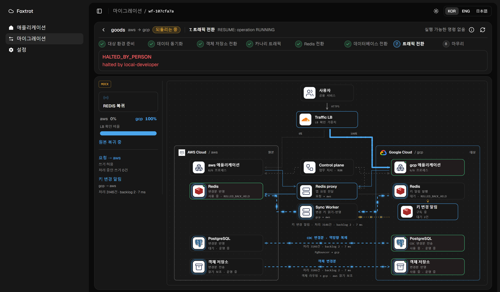
   트래픽 전환 중 일시 정지하고 Redis만 원본으로 되돌리는 화면입니다. 키 변경 알림 구독이 대상 쪽으로 옮겨가고, 복제 방향이 gcp → aws로 바뀝니다. (로컬 시뮬레이션 · 화면의 MOCK 표시)

## 왜 만들었나

- **데이터가 있는 앱은 옮기기 어렵습니다.** 서버는 이미지로 다시 띄우면 되지만, DB 쓰기, Redis 세션과 Pub/Sub 구독, 업로드한 파일은 옮기는 동안에도 계속 바뀝니다.
- **이전 도구는 리소스 하나만 봅니다.** DB 이전 서비스는 DB만, 트래픽 도구는 트래픽만 다룹니다. 어떤 순서로 바꿔야 섞인 상태로 멈추지 않는지는 사람이 맞춰야 합니다.
- **옮기는 것보다 되돌리는 것이 어렵습니다.** 대상에 쓰기가 시작된 뒤에는 원본이 낡습니다. 그래서 언제까지 되돌릴 수 있는지를 플랫폼이 판단해야 합니다.

## 무엇을 골랐나

설계 문서에 남긴 대안과 선택입니다.

| 영역 | 검토한 방식 | Foxtrot의 선택 | 이유 |
|---|---|---|---|
| 진입점 | DNS 가중치 전환 · Envoy 단일 VM | Cloudflare Load Balancer 가중치 | DNS를 바꾸지 않아 캐시 지연이 없습니다. 이전 대상 클라우드 밖에 있어 이전 중에도 진입점이 그대로입니다. Envoy 1대는 단일 장애점입니다. |
| DB | Google DMS (구현·실측함) | PostgreSQL 직접 논리 복제 + PgBouncer | DMS 경로는 쓰기 정지 67.18초(그중 Promote 40.07초), 직접 복제는 2.82초였습니다. 두 측정은 조건이 달라 배수로 비교하지 않습니다. |
| Redis | RIOT 등 복제 도구 | RESP 프록시 + Sync Worker 직접 구현 | 복제 도구는 전환, 단일 쓰기 보장, 롤백, 큐 처리를 다루지 않습니다. |
| Redis 원본 차단 | ElastiCache ACL 변경 API | 자격 증명 분리 | ACL 변경은 비동기라 쓰기 정지 시간 안에 기다릴 수 없습니다. |
| 객체 저장소 | 쓰기 정지 후 복사 | 쓰기를 멈추지 않는 2단계 경로 전환 | 키를 다시 쓰지 않으므로, 읽기를 두 버킷으로 넓힌 뒤 쓰기만 옮기면 됩니다. |
| 전환 순서 | DB 다음 Redis | **Redis 다음 DB** | Redis가 실패해도 DB가 아직 원본이면 Redis만 되돌려 전부 원본으로 돌아갑니다. 반대 순서는 섞인 상태로 멈췄습니다. |

## 구조

<picture>
  <source media="(prefers-color-scheme: dark)" srcset="https://raw.githubusercontent.com/SoftBank-2026-Hackathon-Foxtrot/.github/main/profile/assets/architecture-dark.png">
  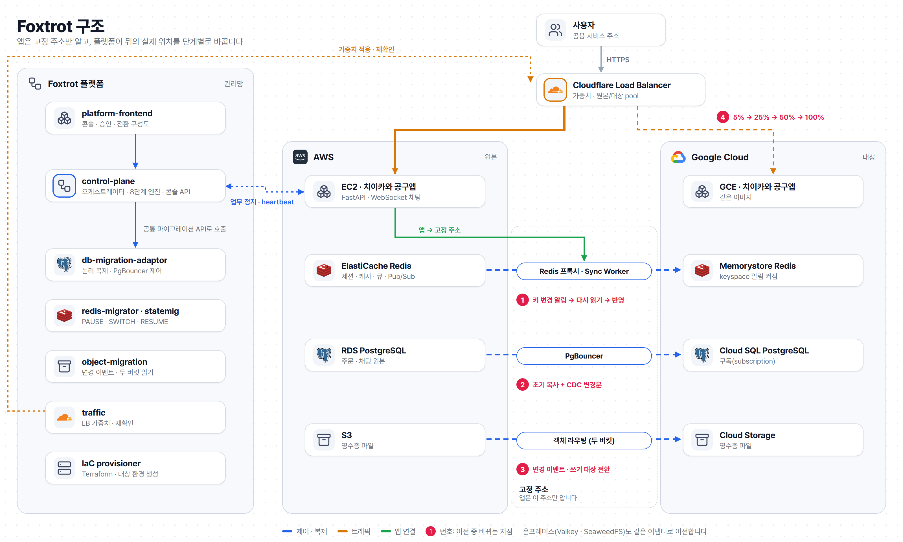
</picture>

| 층 | 구성 | 역할 |
|---|---|---|
| 진입점 | Cloudflare Load Balancer | 사용자 주소는 그대로 두고 원본·대상 pool의 가중치만 바꿉니다. 요청 단위로 나눠 카나리 비율이 바로 반영됩니다. |
| 실행 환경 | AWS EC2 · Google Compute Engine | 같은 이미지의 앱이 양쪽에 뜹니다. 대상 환경은 Terraform으로 만듭니다. |
| 고정 주소 | Redis 프록시 · PgBouncer · 객체 라우팅 | 앱은 이 주소만 압니다. 전환 때 바뀌는 것은 그 뒤의 실제 저장소입니다. |
| 데이터 | ElastiCache ↔ Memorystore · RDS ↔ Cloud SQL · S3 ↔ Cloud Storage | 초기 복사 뒤 변경분을 계속 반영합니다. Redis는 키 변경 알림, DB는 CDC, 객체는 변경 이벤트를 따라갑니다. |
| 관리 평면 | control-plane · 이전 어댑터 · 콘솔 | 상태는 DynamoDB에 두고, 어댑터는 모두 같은 마이그레이션 API를 따릅니다. |

## 이전 과정

| 단계 | 하는 일 | 승인 |
|---|---|---|
| 1. 대상 환경 준비 | 대상 클라우드에 인프라와 앱을 준비합니다. | 계획 승인 |
| 2. 데이터 동기화 | DB · Redis · 객체 저장소를 초기 복사하고 변경분을 계속 반영합니다. | |
| 3. 객체 저장소 전환 | 읽기를 두 버킷으로 넓힌 뒤 쓰기를 대상으로 옮깁니다. 마무리 전까지 원본은 읽기 보조로 남습니다. | |
| 4. 카나리 트래픽 | 트래픽 5%를 대상으로 보내고 실제 업무 경로를 검사합니다. | |
| 5. Redis 전환 | 쓰기를 잠깐 멈추고 프록시의 대상을 바꿉니다. Pub/Sub 구독은 끊기지 않습니다. | 필요 |
| 6. 데이터베이스 전환 | 앱의 업무 정지를 확인하고 마지막 변경분까지 맞춘 뒤 PgBouncer 경로를 바꿉니다. | |
| 7. 트래픽 전환 | 25% → 50% → 100%로 올리고 단계마다 실제 도착 위치를 확인합니다. | |
| 8. 마무리 | 원본 읽기와 복제를 정리합니다. | 필요 |

진행 중에는 일시 정지, 재개, 상태 대조, 리소스별 되돌리기, 취소를 할 수 있습니다. 결과가 불명확하면 대조가 끝날 때까지 다음 변경을 보내지 않습니다. 자동으로 되돌리는 것은 데이터 경로를 바꾸지 않는 트래픽 가중치뿐입니다.

<table>
  <tr>
    <td width="50%">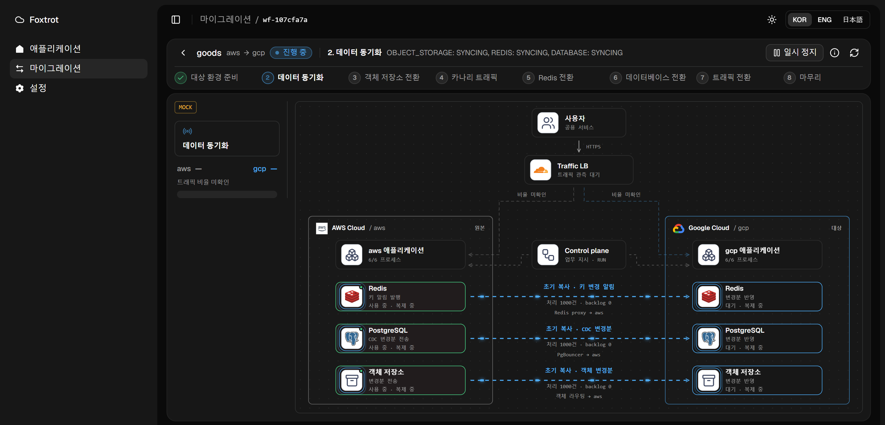</td>
    <td width="50%">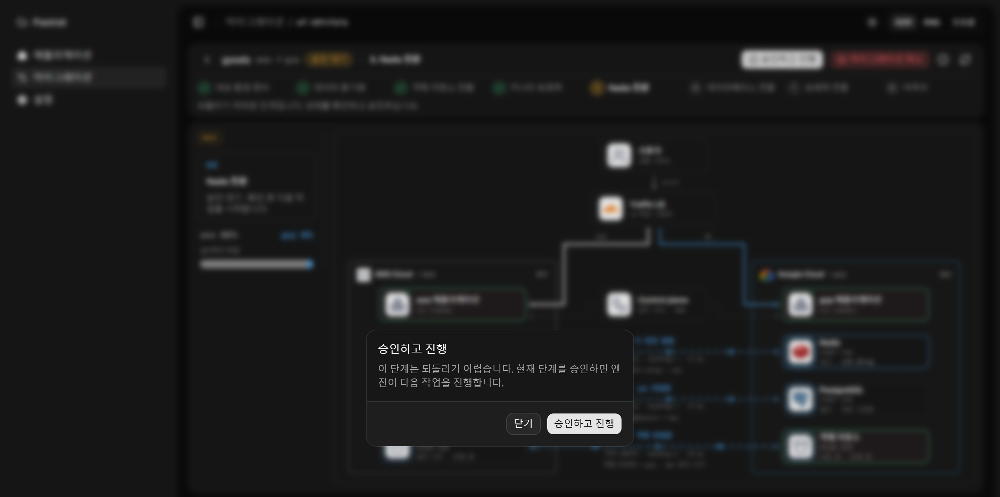</td>
  </tr>
  <tr>
    <td><b>2. 데이터 동기화</b> · 초기 복사와 함께 키 변경 알림, CDC, 객체 변경 이벤트를 따로 보여줍니다.</td>
    <td><b>5. Redis 전환 승인</b> · 되돌리기 어려운 단계는 사람이 확인하고 승인해야 진행합니다.</td>
  </tr>
  <tr>
    <td>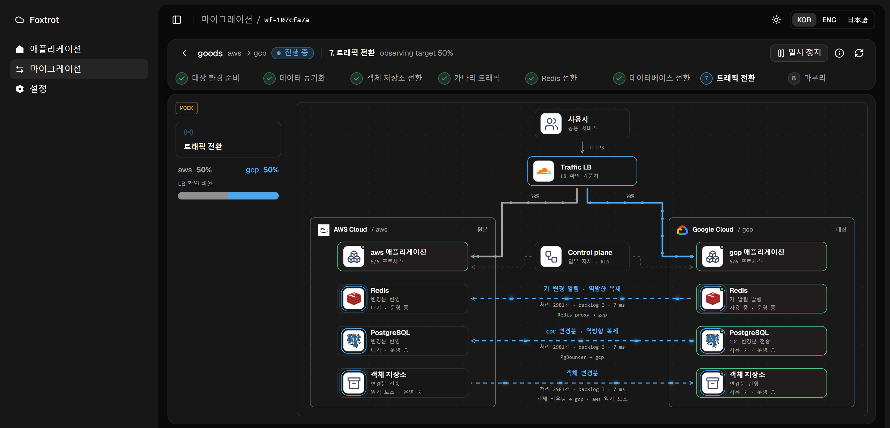</td>
    <td>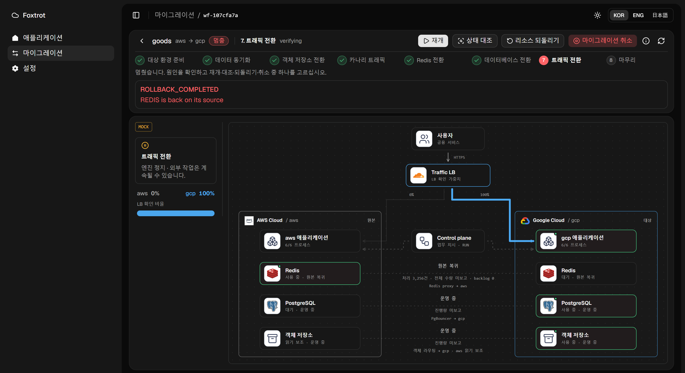</td>
  </tr>
  <tr>
    <td><b>7. 트래픽 전환 50:50</b> · DB와 Redis는 대상에서 운영하고, 되돌림에 대비해 원본으로 역방향 복제합니다.</td>
    <td><b>롤백 완료</b> · Redis 경로가 원본(SOURCE)으로 확인된 뒤에만 복귀를 확정합니다.</td>
  </tr>
  <tr>
    <td>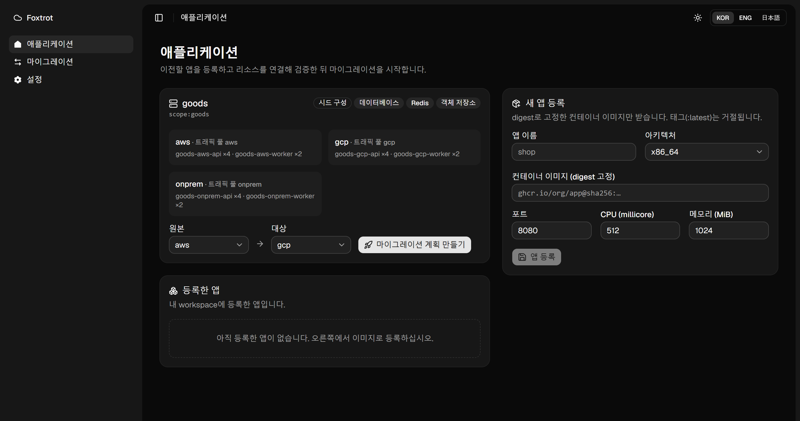</td>
    <td></td>
  </tr>
  <tr>
    <td><b>애플리케이션</b> · digest로 고정한 이미지로 앱을 등록하고, 원본과 대상을 골라 계획을 만듭니다.</td>
    <td><b>이전 대상 앱</b> · 로그인, 공동구매 주문, 영수증, Redis Pub/Sub 실시간 채팅이 있는 치이카와 공구앱입니다.</td>
  </tr>
</table>

콘솔 화면은 실제 control-plane 코드에 가짜 어댑터를 연결해 로컬에서 실행한 것입니다. MOCK 표시는 합성 수치라는 뜻입니다. 위의 실측 수치는 각 저장소가 실제 클라우드에서 기록한 값입니다.

## 파트별 설계

### control-plane · 오케스트레이터
[control-plane](https://github.com/SoftBank-2026-Hackathon-Foxtrot/control-plane) · 이현수

- **상태 없는 틱 엔진.** 틱마다 DynamoDB에서 읽고 한 가지만 수행한 뒤 저장합니다. 외부 변경 전에 의도와 멱등 키를 먼저 기록해, 응답을 잃어도 같은 키로 원래 작업을 찾습니다.
- **모르면 멈춥니다.** 결과가 불명확하면 RECONCILE 전까지 다음 변경을 보내지 않습니다.
- **업무 정지는 짧게.** 정지 중에만 틱을 0.1초, 앱 폴링을 200ms로 줄였습니다. 앱 프로세스 12개 기준 DB 전환 업무 정지가 11.21초에서 1.45초로 줄었습니다(로컬, 10회 중앙값). 대신 정지 중 heartbeat가 프로세스당 초당 5회로 늘어납니다.
- **죽어도 이어갑니다.** 정지 중 엔진을 20회 강제 종료해도 20회 모두 복구했고, 어댑터 명령은 정확히 한 번씩 실행됐습니다. 대가로 잠금 만료를 기다리는 동안 업무 정지가 중앙값 12.6초로 늘어납니다.
- **한계:** 실제 어댑터를 붙인 정지 시간과 클라우드 배포는 아직 재지 않았습니다.

### db-migration-adaptor · PostgreSQL
[db-migration-adaptor](https://github.com/SoftBank-2026-Hackathon-Foxtrot/db-migration-adaptor) · 임태현

- **직접 논리 복제가 기본.** RDS PostgreSQL 17 → Cloud SQL PostgreSQL 17을 초기 복사와 CDC로 따라갑니다. DMS는 명시적으로 고를 때만 쓰고, 실패해도 다른 방식으로 자동 전환하지 않습니다.
- **전환 근거는 LSN.** 업무 정지 근거 → PgBouncer PAUSE → writer 차단 → 최종 barrier · 적용 LSN 확인 → 구독 정지 → 시퀀스 맞춤 → 경로 변경 순서입니다. 정지 중 테이블 전수 비교는 하지 않습니다. 대가로 행 내용 전체 일치는 검사하지 않습니다.
- **실측:** 실제 RDS → Cloud SQL, 주문 5만 건에서 등록부터 쓰기 재개까지 8.58초, 쓰기 정지 2.82초, 쓰기 오류 0건(1회). 로컬 처리량은 0.5 CPU에서 주문 1,471 TPS, 전환 3.52초, 롤백 3.89초입니다.
- **한계:** 롤백은 대상 쓰기 전까지만 됩니다(역방향 CDC 없음). v2 프로필의 클라우드 전환 시간은 아직 다시 재지 않았습니다.

### redis-migrator · Redis
[redis-migrator](https://github.com/SoftBank-2026-Hackathon-Foxtrot/redis-migrator) · 이현수

- **Go 프록시.** 앱은 RESP 프록시 주소만 압니다. 전환 때 쓰기를 잠깐 멈추고 프록시의 대상을 바꿉니다. 한 프로세스에서 여러 코어를 쓰려고 Go로 만들었습니다.
- **키 변경 알림은 계기입니다.** Sync Worker가 keyspace 알림을 구독하고, 바뀐 키를 다시 읽어 대상에 씁니다. Pub/Sub 구독은 전환 중에도 유지되고, 작업 큐는 복사하지 않고 원본을 다 소비한 뒤 소비자를 옮깁니다.
- **검증은 샘플 방식.** 전체 비교는 쓰기 정지 전에 하고, 그 뒤에는 바뀐 키만 다시 봅니다. 알림 없이 대상 값만 바뀌는 경우를 놓칠 수 있는 위험은 감수했습니다.
- **실측:** ElastiCache Valkey · Memorystore · 온프레 Valkey를 Tailscale로 연결해, 키 30만 개에서 전환·정상 롤백 쓰기 정지 46~61ms, 요청 실패 0건. Pub/Sub 유실·중복, WebSocket 끊김, 로그인 실패 0건. 장애 롤백은 318~334ms였고 회차마다 요청 실패가 1건 있었습니다.

### object-migration · 객체 저장소
[object-migration](https://github.com/SoftBank-2026-Hackathon-Foxtrot/object-migration) · 노영진

- **쓰기를 멈추지 않습니다.** 키를 다시 쓰지 않으므로, 읽기를 두 버킷으로 넓힌 뒤 쓰기만 대상으로 옮깁니다.
- **앱이 확인해야 다음 단계.** 앱은 5초 리스로 경로를 갱신하고, 모든 앱이 적용했다고 확인해야 넘어갑니다. 삭제할 키를 먼저 기록해 복사와 삭제가 어느 순서로 끝나도 결과가 맞습니다.
- **변경 피드:** S3는 SQS, Cloud Storage는 Pub/Sub, SeaweedFS는 filer 구독을 따라갑니다.
- **실측:** 실제 버킷과 앱 시뮬레이터 3개로 7개 방향(롤백 포함) 실패 0건. 서버를 SIGKILL로 죽였다 살려도 S3 → GCS 9,361건, SeaweedFS → GCS 20,122건에서 실패 · 누락 · 잔존 0건.
- **한계:** 서버 간 인증과 메트릭은 아직 없습니다.

### traffic · 진입점
[traffic](https://github.com/SoftBank-2026-Hackathon-Foxtrot/traffic) · 임채준

- **Cloudflare LB 가중치.** steering은 random, 세션 어피니티는 껐습니다. 세션은 Redis에 있으므로 요청 단위로 나눠도 됩니다.
- **API 성공 ≠ 반영 완료.** 95:5에서 keepalive 연결은 GCP 0.0%, 매번 새 연결은 7.7%가 도착했습니다. 그래서 적용 후 실제 도착 위치를 다시 확인합니다.
- **`/readyz`는 DB를 보지 않습니다.** DB 전환 중 PgBouncer가 멈춰도 모든 pool이 동시에 빠지지 않게 하기 위해서입니다.
- **실측:** 실제 EC2 ↔ GCE에서 100:0 → 95:5 → 50:50 → 0:100 → 롤백 동안 3,000건 실패 0건(p95 110ms). 실험 전체 HTTP 13,000건 실패 0건.

### IaC · 환경
[IaC](https://github.com/SoftBank-2026-Hackathon-Foxtrot/IaC) · 김정빈 · 노영진

- 원본과 대상 환경(네트워크, RDS · Cloud SQL, ElastiCache · Memorystore, S3 · Cloud Storage, 앱 서버)을 Terraform으로 만들고, 레지스트리 이미지로 실행 중인 앱까지 띄웁니다.
- **AI 추천은 사양만.** HCL, IAM, CIDR, 공개 여부는 바꾸지 않습니다. plan을 확인한 뒤 같은 saved plan을 실행합니다.
- **실측:** 실제 EC2 → GCE 컴퓨트 리허설에서 세션 요청 291건 모두 성공(p95 19.3ms), 정리 후 잔여 자원 0개.

### platform-frontend · 콘솔
[platform-frontend](https://github.com/SoftBank-2026-Hackathon-Foxtrot/platform-frontend) · 이현수 · 임태현

- React · TypeScript · TanStack Query · shadcn/ui, Feature-Sliced Design. 한국어 · English · 日本語를 지원합니다.
- **보고된 것만 그립니다.** 전환 구성도는 백엔드가 보고한 경로와 스트림만 움직입니다. 측정되지 않은 값은 0이 아니라 미확인으로 표시합니다.
- 명령은 멱등 키와 기대 버전을 함께 보냅니다. 응답은 런타임 스키마로 검증합니다.

### demo · 이전 대상 앱
[demo](https://github.com/SoftBank-2026-Hackathon-Foxtrot/demo) · 이현수

- FastAPI와 React로 만든 라이브 공동구매 앱입니다. 세션 · 캐시 · 큐 · 채팅 전달은 Redis, 주문과 채팅 기록은 PostgreSQL, 영수증은 객체 저장소에 둡니다.
- 플랫폼의 업무 정지 지시와 Redis · 객체 경로 지시를 따릅니다. 업무 정지 해제 후 0.45초 안에 프로세스 6개가 모두 재개했습니다(로컬).

## 아직 하지 않은 것

- 네 계층을 실제 클라우드에서 **한 번에** 옮긴 통합 실측은 아직 없습니다. 계층별 실측과 control-plane 로컬 통합까지 했습니다.
- DB는 대상 쓰기 이후 원본으로 되돌리는 역방향 복제를 아직 구성하지 않았습니다.
- 온프레미스 진입점과 서버 간 인증은 설계 단계입니다.

## 팀

<table>
  <tr>
    <td align="center"><a href="https://github.com/hyunsuhahaha"> <b>이현수</b></a> 플랫폼 백엔드 · 콘솔 Redis · 데모 앱</td>
    <td align="center"><a href="https://github.com/noeulnight"> <b>임태현</b></a> DB 마이그레이션 콘솔 API</td>
    <td align="center"><a href="https://github.com/yyoungjin"> <b>노영진</b></a> 객체 저장소 IaC</td>
    <td align="center"><a href="https://github.com/dlacowns21"> <b>임채준</b></a> 트래픽 계층</td>
    <td align="center"><a href="https://github.com/SuperSon7"> <b>김정빈</b></a> IaC · 배포 관측</td>
  </tr>
</table>

| 저장소 | 내용 |
|---|---|
| [control-plane](https://github.com/SoftBank-2026-Hackathon-Foxtrot/control-plane) | 오케스트레이터와 콘솔 API |
| [platform-frontend](https://github.com/SoftBank-2026-Hackathon-Foxtrot/platform-frontend) | 플랫폼 콘솔 |
| [db-migration-adaptor](https://github.com/SoftBank-2026-Hackathon-Foxtrot/db-migration-adaptor) | PostgreSQL 논리 복제 · PgBouncer |
| [redis-migrator](https://github.com/SoftBank-2026-Hackathon-Foxtrot/redis-migrator) | Redis 프록시 · Sync Worker |
| [object-migration](https://github.com/SoftBank-2026-Hackathon-Foxtrot/object-migration) | S3 · Cloud Storage · SeaweedFS |
| [traffic](https://github.com/SoftBank-2026-Hackathon-Foxtrot/traffic) | Cloudflare 가중치 · Tailscale |
| [IaC](https://github.com/SoftBank-2026-Hackathon-Foxtrot/IaC) | Terraform · 앱 환경 프로비저닝 |
| [demo](https://github.com/SoftBank-2026-Hackathon-Foxtrot/demo) | 이전 대상 앱 |
| [design-docs](https://softbank-2026-hackathon-foxtrot.github.io/design-docs/architecture/) | 설계 도식 |

---

## Foxtrot とは

**稼働中のアプリのデータベース、Redis、オブジェクトストレージ、トラフィックを、AWS · Google Cloud · オンプレミスの間で移すプラットフォーム**です。

アプリが知っているのは固定アドレス(Redis プロキシ、PgBouncer、オブジェクトルーティング)だけです。プラットフォームはその裏の実体を決まった順番で切り替えます。まずコピーし、差分を追い続け、リソースを一つずつ切り替え、トラフィックを段階的に移します。元に戻しにくい段階では人が承認し、問題があればリソース単位で戻します。

**実クラウドでの測定結果** · レイヤーごとの測定です。

| レイヤー | 経路 | 結果 |
|---|---|---|
| PostgreSQL | RDS → Cloud SQL、注文 5万件 | 書き込み停止 **2.82秒**、書き込みエラー **0件** |
| Redis | ElastiCache ↔ Memorystore、キー 30万個 | 切り替え・ロールバックの書き込み停止 **46~61ms**、リクエスト失敗 **0件** |
| オブジェクト | S3 · Cloud Storage · SeaweedFS の7方向 | ロールバックを含めリクエスト失敗 **0件** |
| トラフィック | EC2 ↔ GCE、100:0 → 95:5 → 50:50 → 0:100 → ロールバック | 連続リクエスト 3,000件中 失敗 **0件** |

  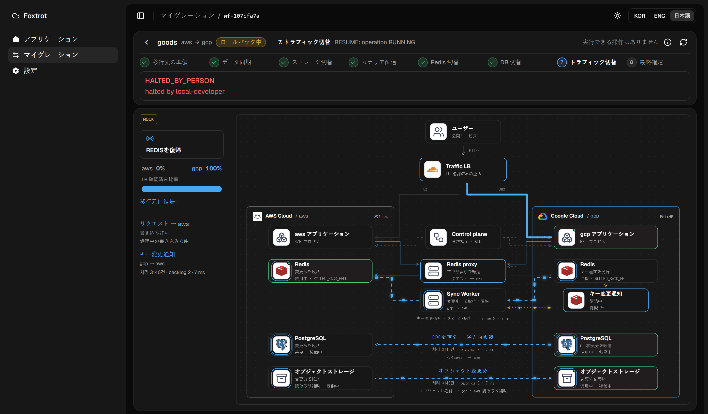
   トラフィック切り替え中に一時停止し、Redis だけを移行元に戻している画面です。キー変更通知の購読が移行先側に移り、複製の向きが gcp → aws に変わります。(ローカルシミュレーション · 画面の MOCK 表示)

## なぜ必要か

- **データを持つアプリは移しにくい。** サーバーはイメージから起動し直せますが、DB の書き込み、Redis のセッションと Pub/Sub 購読、アップロードしたファイルは移行中も変わり続けます。
- **移行ツールは一つのリソースしか見ない。** どの順番で切り替えれば混ざった状態で止まらないかは、人が合わせる必要があります。
- **移すより戻す方が難しい。** 移行先への書き込みが始まると移行元は古くなります。いつまで戻せるかをプラットフォームが判断する必要があります。

## 何を選んだか

| 領域 | 検討した方式 | Foxtrot の選択 | 理由 |
|---|---|---|---|
| エントリ | DNS の重み · Envoy 1台 | Cloudflare Load Balancer の重み | DNS を変えないのでキャッシュによる遅れがありません。移行対象のクラウドの外にあり、移行中もエントリが変わりません。Envoy 1台は単一障害点です。 |
| DB | Google DMS(実装・測定済み) | PostgreSQL 直接の論理レプリケーション + PgBouncer | DMS 経路は書き込み停止 67.18秒(うち Promote 40.07秒)、直接レプリケーションは 2.82秒でした。条件が違うため倍数では比べません。 |
| Redis | RIOT などの複製ツール | RESP プロキシ + Sync Worker を自作 | 複製ツールは切り替え、単一書き込みの保証、ロールバック、キュー処理を扱いません。 |
| オブジェクト | 書き込みを止めてコピー | 書き込みを止めない2段階の経路切り替え | キーを上書きしないので、読み取りを2バケットに広げてから書き込みだけを移せば足ります。 |
| 切り替え順 | DB の次に Redis | **Redis の次に DB** | Redis が失敗しても DB がまだ移行元なら、Redis だけを戻せば全体が移行元に戻ります。逆の順番では混ざった状態で止まりました。 |

## 構成

<picture>
  <source media="(prefers-color-scheme: dark)" srcset="https://raw.githubusercontent.com/SoftBank-2026-Hackathon-Foxtrot/.github/main/profile/assets/architecture-dark.ja.png">
  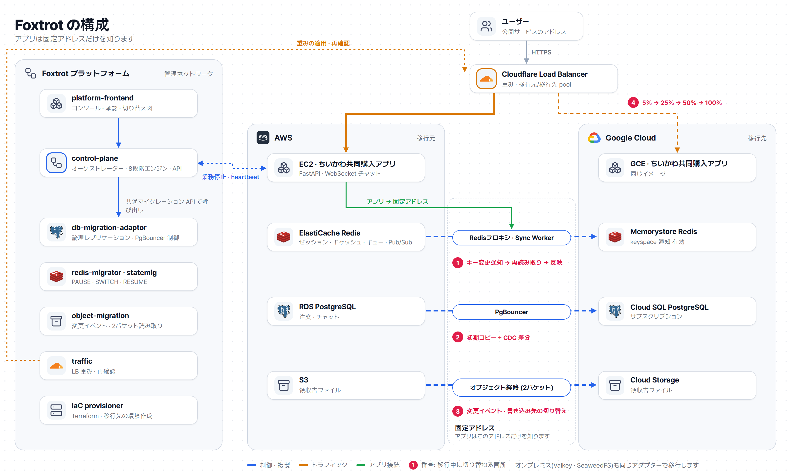
</picture>

## 移行の流れ

| 段階 | 内容 | 承認 |
|---|---|---|
| 1. 移行先の準備 | 移行先クラウドにインフラとアプリを用意します。 | 計画の承認 |
| 2. データ同期 | DB · Redis · オブジェクトを初期コピーし、差分を反映し続けます。 | |
| 3. オブジェクト切り替え | 読み取りを2バケットに広げてから、書き込みを移行先に移します。 | |
| 4. カナリア | トラフィックの5%を移行先に送り、実際の業務経路を検査します。 | |
| 5. Redis 切り替え | 書き込みを一瞬止めてプロキシの接続先を変えます。Pub/Sub 購読は切れません。 | 必要 |
| 6. DB 切り替え | アプリの業務停止を確認し、最後の差分まで合わせてから PgBouncer の経路を変えます。 | |
| 7. トラフィック切り替え | 25% → 50% → 100% と上げ、段階ごとに実際の到着先を確認します。 | |
| 8. 仕上げ | 移行元の読み取りと複製を片付けます。 | 必要 |

<table>
  <tr>
    <td width="50%">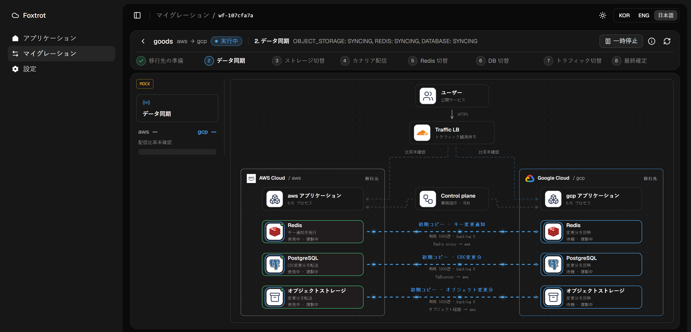</td>
    <td width="50%">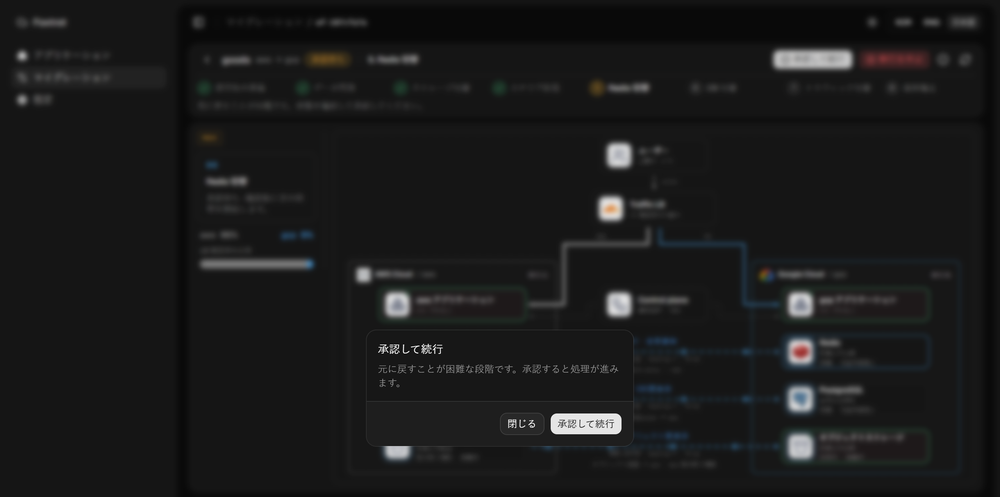</td>
  </tr>
  <tr>
    <td><b>2. データ同期</b> · 初期コピーと、キー変更通知 · CDC · オブジェクト変更イベントを分けて表示します。</td>
    <td><b>5. Redis 切り替えの承認</b> · 元に戻しにくい段階は人が確認して承認します。</td>
  </tr>
  <tr>
    <td>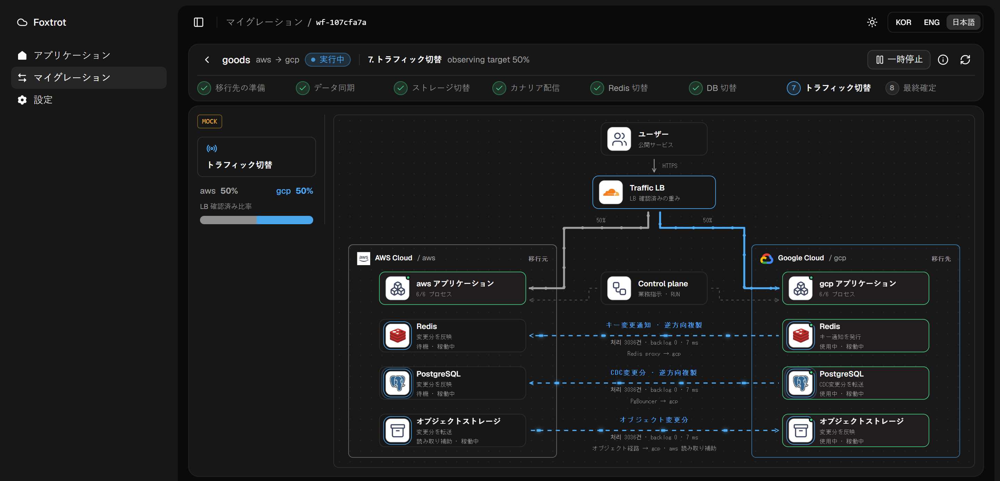</td>
    <td>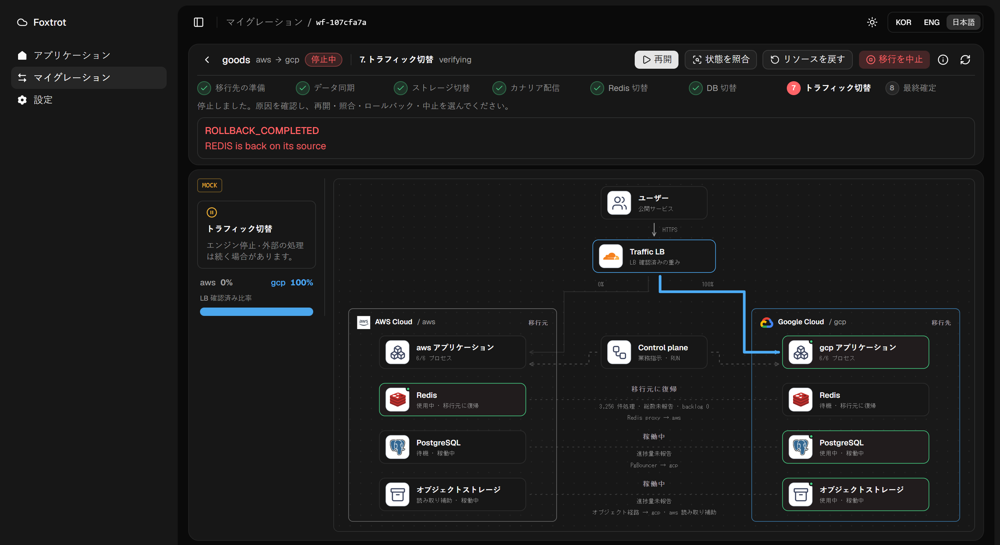</td>
  </tr>
  <tr>
    <td><b>7. トラフィック 50:50</b> · DB と Redis は移行先で稼働し、戻せるよう移行元へ逆方向に複製します。</td>
    <td><b>ロールバック完了</b> · Redis の経路が移行元(SOURCE)に戻ったと確認できてから確定します。</td>
  </tr>
</table>

## パートごとの設計

| パート | 担当 | 要点 | 実測 |
|---|---|---|---|
| [control-plane](https://github.com/SoftBank-2026-Hackathon-Foxtrot/control-plane) | 이현수 | 状態を持たないティックエンジン。外部変更の前に意図と冪等キーを記録し、結果が不明なら RECONCILE まで止まります。 | 業務停止 11.21秒 → 1.45秒(ローカル、12プロセス)。停止中の強制終了20回すべて復旧、コマンドはちょうど1回ずつ。 |
| [db-migration-adaptor](https://github.com/SoftBank-2026-Hackathon-Foxtrot/db-migration-adaptor) | 임태현 | 直接の論理レプリケーション(初期コピー + CDC)。最終 LSN を根拠に PgBouncer の経路を切り替えます。 | RDS → Cloud SQL、注文5万件で書き込み停止 2.82秒、エラー0件。 |
| [redis-migrator](https://github.com/SoftBank-2026-Hackathon-Foxtrot/redis-migrator) | 이현수 | Go の RESP プロキシ。Sync Worker が keyspace 通知を購読し、変わったキーを読み直して反映します。 | キー30万個で書き込み停止 46~61ms、失敗0件。Pub/Sub の欠落 · 重複0件。 |
| [object-migration](https://github.com/SoftBank-2026-Hackathon-Foxtrot/object-migration) | 노영진 | 書き込みを止めない2段階の経路切り替え。SQS · Pub/Sub · filer 購読で変更を追います。 | 7方向で失敗0件。SIGKILL 再起動でも欠落 · 残存0件。 |
| [traffic](https://github.com/SoftBank-2026-Hackathon-Foxtrot/traffic) | 임채준 | Cloudflare LB の重み。API の成功だけでなく実際の到着先を確認します。 | EC2 ↔ GCE で 3,000件中失敗0件(p95 110ms)。 |
| [IaC](https://github.com/SoftBank-2026-Hackathon-Foxtrot/IaC) | 김정빈 · 노영진 | Terraform で移行元 · 移行先の環境と稼働中のアプリまで作ります。AI の推奨はサイズだけです。 | EC2 → GCE のリハーサルでセッションリクエスト 291件すべて成功。 |
| [platform-frontend](https://github.com/SoftBank-2026-Hackathon-Foxtrot/platform-frontend) | 이현수 · 임태현 | 報告された値だけを描く切り替え図。韓国語 · 英語 · 日本語。 | — |
| [demo](https://github.com/SoftBank-2026-Hackathon-Foxtrot/demo) | 이현수 | 移行対象のライブ共同購入アプリ。業務停止と経路の指示に従います。 | 業務停止の解除後 0.45秒で6プロセスが再開(ローカル)。 |

## まだできていないこと

- 4つのレイヤーを実クラウドで**一度に**移した統合測定はまだありません。レイヤーごとの実測と control-plane のローカル統合までです。
- DB は移行先への書き込み後に移行元へ戻す逆方向レプリケーションをまだ構成していません。
- オンプレミスのエントリとサーバー間認証は設計段階です。
