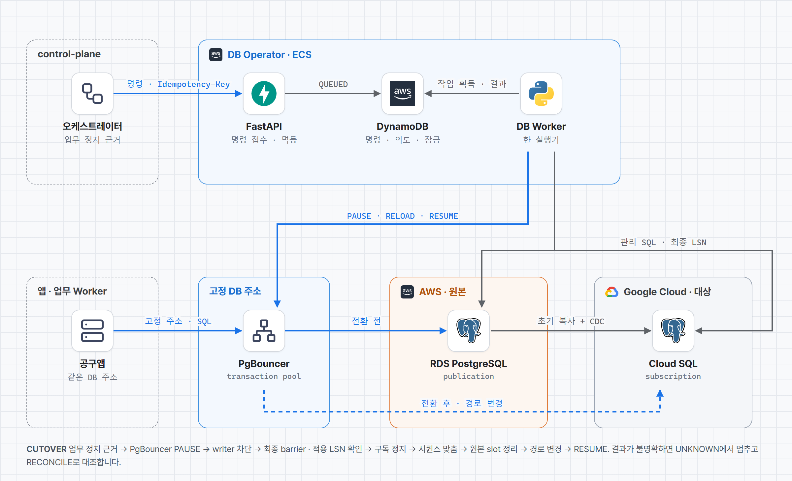
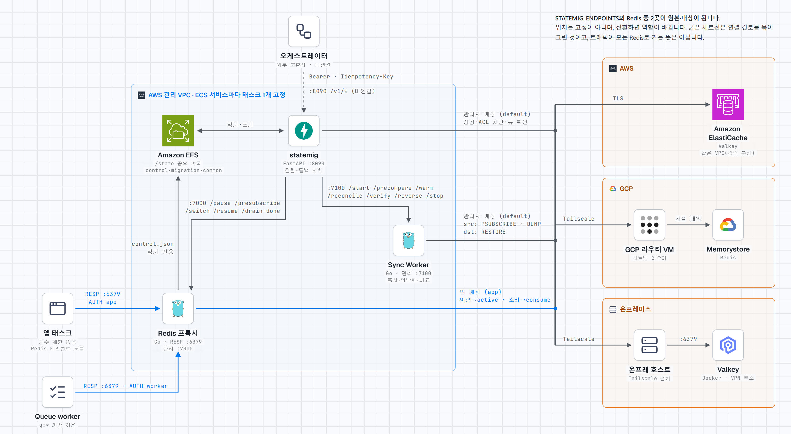
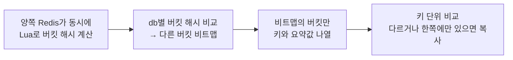
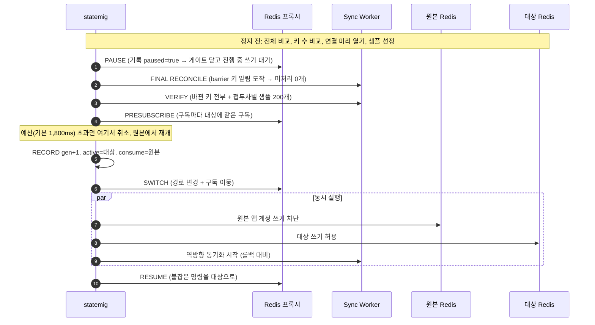
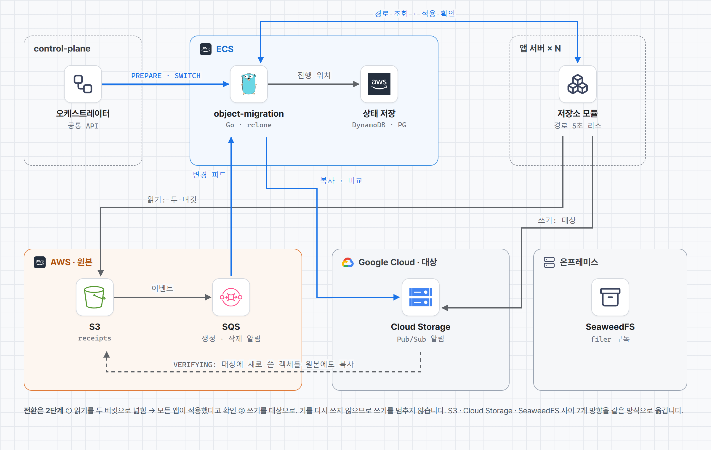
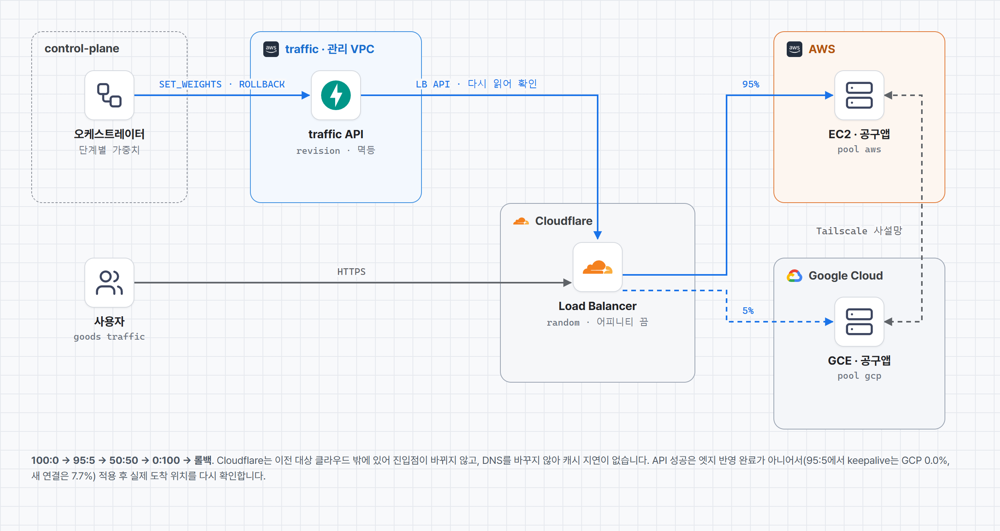
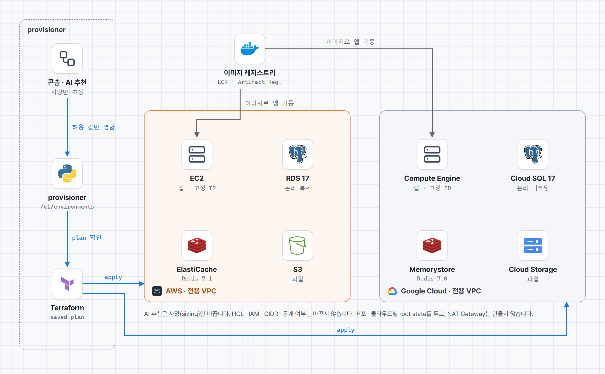
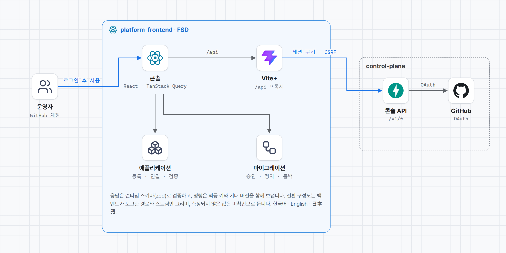

<p align="center">
  
</p>

<p align="center">
  <b>Team Foxtrot</b> · SoftBank Hackathon 2026 in Korea 본선<br>
  <a href="#한국어">한국어</a> · <a href="#日本語">日本語</a>
</p>

---

<a id="한국어"></a>

## Foxtrot은

**실행 중인 앱의 데이터베이스, Redis, 객체 저장소, 트래픽을 AWS · Google Cloud · 온프레미스 사이에서 옮기는 플랫폼**입니다.

앱은 고정 주소만 압니다. Redis 프록시, PgBouncer, 객체 라우팅이 그 주소입니다. 플랫폼은 그 뒤의 실제 저장소를 정해진 순서로 바꿉니다. 먼저 복사하고, 변경분을 계속 따라잡고, 리소스를 하나씩 전환하고, 트래픽을 단계적으로 옮깁니다. 되돌리기 어려운 단계마다 사람이 승인하고, 문제가 생기면 리소스 단위로 되돌립니다.

**실제 클라우드에서 잰 결과** · 계층별 측정입니다.

| 계층 | 경로 | 결과 |
|---|---|---|
| PostgreSQL | RDS → Cloud SQL, 주문 5만 건 | 쓰기 정지 **2.82초**, 쓰기 오류 **0건** |
| Redis | ElastiCache ↔ Memorystore, 키 30만 개 | 전환·롤백 쓰기 정지 **46~61ms**, 요청 실패 **0건** |
| 객체 저장소 | S3 · Cloud Storage · SeaweedFS 7개 방향 | 롤백 포함 요청 실패 **0건** |
| 트래픽 | EC2 ↔ GCE, 100:0 → 95:5 → 50:50 → 0:100 → 롤백 | 연속 요청 3,000건 중 실패 **0건** |

<p align="center">
  
  <br><sub>트래픽 전환 중 일시 정지하고 Redis만 원본으로 되돌리는 화면입니다. 키 변경 알림 구독이 대상 쪽으로 옮겨가고, 복제 방향이 gcp → aws로 바뀝니다. (로컬 시뮬레이션 · 화면의 MOCK 표시)</sub>
</p>

## 왜 만들었나

- **데이터가 있는 앱은 옮기기 어렵습니다.** 서버는 이미지로 다시 띄우면 되지만, DB 쓰기, Redis 세션과 Pub/Sub 구독, 업로드한 파일은 옮기는 동안에도 계속 바뀝니다.
- **이전 도구는 리소스 하나만 봅니다.** DB 이전 서비스는 DB만, 트래픽 도구는 트래픽만 다룹니다. 어떤 순서로 바꿔야 섞인 상태로 멈추지 않는지는 사람이 맞춰야 합니다.
- **옮기는 것보다 되돌리는 것이 어렵습니다.** 대상에 쓰기가 시작된 뒤에는 원본이 낡습니다. 그래서 언제까지 되돌릴 수 있는지를 플랫폼이 판단해야 합니다.

## 무엇을 골랐나

설계 문서에 남긴 대안과 선택입니다.

| 영역 | 검토한 방식 | Foxtrot의 선택 | 이유 |
|---|---|---|---|
| 진입점 | DNS 가중치 전환 · Envoy 단일 VM | Cloudflare Load Balancer 가중치 | DNS를 바꾸지 않아 캐시 지연이 없습니다. 이전 대상 클라우드 밖에 있어 이전 중에도 진입점이 그대로입니다. Envoy 1대는 단일 장애점입니다. |
| DB | Google DMS (구현·실측함) | PostgreSQL 직접 논리 복제 + PgBouncer | DMS 경로는 쓰기 정지 67.18초(그중 Promote 40.07초), 직접 복제는 2.82초였습니다. 두 측정은 조건이 달라 배수로 비교하지 않습니다. |
| Redis | RIOT 등 복제 도구 | RESP 프록시 + Sync Worker 직접 구현 | 복제 도구는 전환, 단일 쓰기 보장, 롤백, 큐 처리를 다루지 않습니다. |
| Redis 원본 차단 | ElastiCache ACL 변경 API | 자격 증명 분리 | ACL 변경은 비동기라 쓰기 정지 시간 안에 기다릴 수 없습니다. |
| 객체 저장소 | 쓰기 정지 후 복사 | 쓰기를 멈추지 않는 2단계 경로 전환 | 키를 다시 쓰지 않으므로, 읽기를 두 버킷으로 넓힌 뒤 쓰기만 옮기면 됩니다. |
| 전환 순서 | DB 다음 Redis | **Redis 다음 DB** | Redis가 실패해도 DB가 아직 원본이면 Redis만 되돌려 전부 원본으로 돌아갑니다. 반대 순서는 섞인 상태로 멈췄습니다. |

## 구조

<picture>
  <source media="(prefers-color-scheme: dark)" srcset="https://raw.githubusercontent.com/SoftBank-2026-Hackathon-Foxtrot/.github/main/profile/assets/architecture-dark.png">
  
</picture>

| 층 | 구성 | 역할 |
|---|---|---|
| 진입점 | Cloudflare Load Balancer | 사용자 주소는 그대로 두고 원본·대상 pool의 가중치만 바꿉니다. 요청 단위로 나눠 카나리 비율이 바로 반영됩니다. |
| 실행 환경 | AWS EC2 · Google Compute Engine | 같은 이미지의 앱이 양쪽에 뜹니다. 대상 환경은 Terraform으로 만듭니다. |
| 고정 주소 | Redis 프록시 · PgBouncer · 객체 라우팅 | 앱은 이 주소만 압니다. 전환 때 바뀌는 것은 그 뒤의 실제 저장소입니다. |
| 데이터 | ElastiCache ↔ Memorystore · RDS ↔ Cloud SQL · S3 ↔ Cloud Storage | 초기 복사 뒤 변경분을 계속 반영합니다. Redis는 키 변경 알림, DB는 CDC, 객체는 변경 이벤트를 따라갑니다. |
| 관리 평면 | control-plane · 이전 어댑터 · 콘솔 | 상태는 DynamoDB에 두고, 어댑터는 모두 같은 마이그레이션 API를 따릅니다. |

## 이전 과정

| 단계 | 하는 일 | 승인 |
|---|---|---|
| 1. 대상 환경 준비 | 대상 클라우드에 인프라와 앱을 준비합니다. | 계획 승인 |
| 2. 데이터 동기화 | DB · Redis · 객체 저장소를 초기 복사하고 변경분을 계속 반영합니다. | |
| 3. 객체 저장소 전환 | 읽기를 두 버킷으로 넓힌 뒤 쓰기를 대상으로 옮깁니다. 마무리 전까지 원본은 읽기 보조로 남습니다. | |
| 4. 카나리 트래픽 | 트래픽 5%를 대상으로 보내고 실제 업무 경로를 검사합니다. | |
| 5. Redis 전환 | 쓰기를 잠깐 멈추고 프록시의 대상을 바꿉니다. Pub/Sub 구독은 끊기지 않습니다. | 필요 |
| 6. 데이터베이스 전환 | 앱의 업무 정지를 확인하고 마지막 변경분까지 맞춘 뒤 PgBouncer 경로를 바꿉니다. | |
| 7. 트래픽 전환 | 25% → 50% → 100%로 올리고 단계마다 실제 도착 위치를 확인합니다. | |
| 8. 마무리 | 원본 읽기와 복제를 정리합니다. | 필요 |

진행 중에는 일시 정지, 재개, 상태 대조, 리소스별 되돌리기, 취소를 할 수 있습니다. 결과가 불명확하면 대조가 끝날 때까지 다음 변경을 보내지 않습니다. 자동으로 되돌리는 것은 데이터 경로를 바꾸지 않는 트래픽 가중치뿐입니다.

<table>
  <tr>
    <td width="50%"></td>
    <td width="50%"></td>
  </tr>
  <tr>
    <td><sub><b>2. 데이터 동기화</b> · 초기 복사와 함께 키 변경 알림, CDC, 객체 변경 이벤트를 따로 보여줍니다.</sub></td>
    <td><sub><b>5. Redis 전환 승인</b> · 되돌리기 어려운 단계는 사람이 확인하고 승인해야 진행합니다.</sub></td>
  </tr>
  <tr>
    <td></td>
    <td></td>
  </tr>
  <tr>
    <td><sub><b>7. 트래픽 전환 50:50</b> · DB와 Redis는 대상에서 운영하고, 되돌림에 대비해 원본으로 역방향 복제합니다.</sub></td>
    <td><sub><b>롤백 완료</b> · Redis 경로가 원본(SOURCE)으로 확인된 뒤에만 복귀를 확정합니다.</sub></td>
  </tr>
  <tr>
    <td></td>
    <td></td>
  </tr>
  <tr>
    <td><sub><b>애플리케이션</b> · digest로 고정한 이미지로 앱을 등록하고, 원본과 대상을 골라 계획을 만듭니다.</sub></td>
    <td><sub><b>이전 대상 앱</b> · 로그인, 공동구매 주문, 영수증, Redis Pub/Sub 실시간 채팅이 있는 치이카와 공구앱입니다.</sub></td>
  </tr>
</table>

<sub>콘솔 화면은 실제 control-plane 코드에 가짜 어댑터를 연결해 로컬에서 실행한 것입니다. MOCK 표시는 합성 수치라는 뜻입니다. 위의 실측 수치는 각 저장소가 실제 클라우드에서 기록한 값입니다.</sub>

## 파트별 설계

### control-plane · 오케스트레이터
[control-plane](https://github.com/SoftBank-2026-Hackathon-Foxtrot/control-plane) · 이현수


- **상태 없는 틱 엔진.** 틱마다 DynamoDB에서 읽고 한 가지만 수행한 뒤 저장합니다. 외부 변경 전에 의도와 멱등 키를 먼저 기록해, 응답을 잃어도 같은 키로 원래 작업을 찾습니다.
- **모르면 멈춥니다.** 결과가 불명확하면 RECONCILE 전까지 다음 변경을 보내지 않습니다.
- **업무 정지는 짧게.** 정지 중에만 틱을 0.1초, 앱 폴링을 200ms로 줄였습니다. 앱 프로세스 12개 기준 DB 전환 업무 정지가 11.21초에서 1.45초로 줄었습니다(로컬, 10회 중앙값). 대신 정지 중 heartbeat가 프로세스당 초당 5회로 늘어납니다.
- **죽어도 이어갑니다.** 정지 중 엔진을 20회 강제 종료해도 20회 모두 복구했고, 어댑터 명령은 정확히 한 번씩 실행됐습니다. 대가로 잠금 만료를 기다리는 동안 업무 정지가 중앙값 12.6초로 늘어납니다.
- **한계:** 실제 어댑터를 붙인 정지 시간과 클라우드 배포는 아직 재지 않았습니다.

### db-migration-adaptor · PostgreSQL
[db-migration-adaptor](https://github.com/SoftBank-2026-Hackathon-Foxtrot/db-migration-adaptor) · 임태현



- **직접 논리 복제가 기본.** RDS PostgreSQL 17 → Cloud SQL PostgreSQL 17을 초기 복사와 CDC로 따라갑니다. DMS는 명시적으로 고를 때만 쓰고, 실패해도 다른 방식으로 자동 전환하지 않습니다.
- **전환 근거는 LSN.** 업무 정지 근거 → PgBouncer PAUSE → writer 차단 → 최종 barrier · 적용 LSN 확인 → 구독 정지 → 시퀀스 맞춤 → 경로 변경 순서입니다. 정지 중 테이블 전수 비교는 하지 않습니다. 대가로 행 내용 전체 일치는 검사하지 않습니다.
- **실측:** 실제 RDS → Cloud SQL, 주문 5만 건에서 등록부터 쓰기 재개까지 8.58초, 쓰기 정지 2.82초, 쓰기 오류 0건(1회). 로컬 처리량은 0.5 CPU에서 주문 1,471 TPS, 전환 3.52초, 롤백 3.89초입니다.
- **한계:** 롤백은 대상 쓰기 전까지만 됩니다(역방향 CDC 없음). v2 프로필의 클라우드 전환 시간은 아직 다시 재지 않았습니다.

### redis-migrator · Redis
[redis-migrator](https://github.com/SoftBank-2026-Hackathon-Foxtrot/redis-migrator) · 이현수 · [상세 설계](https://app.notion.com/p/40f8bee9ada481c080bdd4b4e8109e45)

**앱 코드·설정·재시작 없이, 세션을 잃지 않고, Redis를 클라우드 사이에서 옮깁니다.** ElastiCache와 Memorystore는 외부 서버로의 `REPLICAOF`를 허용하지 않고 `CONFIG`와 `ACL`도 막혀 있습니다. 그래서 복사, 비교, 전환을 모두 **일반 클라이언트 명령만으로** 구현했습니다.

| 실측 (ElastiCache Valkey 8.0 ↔ Memorystore Redis 7.2 ↔ 온프레 Valkey, Tailscale) | 결과 |
|---|---|
| 컷오버 · 정상 롤백 쓰기 정지 (키 30만 개) | **46~61ms**, 요청 실패 · 세션 유실 **0건** |
| 전환 중 Pub/Sub 채팅 | 유실 · 중복 **0건**, WebSocket 끊김 **0건** |
| 대상 장애 시 롤백 쓰기 정지 | **318~334ms** (SYN 재전송 대기를 없애 4.1초에서 단축) |
| 엔진이 다른 Redis 사이 (Valkey 8.0 ↔ Redis 7.2) | `DUMP`/`RESTORE` 양방향 동작, Lua 버킷 비교 두 제품 모두 동작 |
| 연속 이전 | AWS → 온프레 → GCP, 같은 도구 · 같은 절차 |

<picture>
  <source media="(prefers-color-scheme: dark)" srcset="https://raw.githubusercontent.com/SoftBank-2026-Hackathon-Foxtrot/.github/main/profile/assets/repos/redis-dark.png">
  
</picture>

**구성.** 앱은 고정 주소의 **Go RESP 프록시**에만 접속합니다. 앱용 Redis 비밀번호는 프록시만 압니다. **Sync Worker**(Go)는 요청 경로 밖에서 양쪽 Redis를 맞추고, **statemig**(FastAPI)가 단계를 지시합니다. 전환 기록 `control.json`(세대 `gen`, 쓰기 대상 `active`, 큐 소비 대상 `consume`, 정지 여부 `paused`)은 EFS에 두고 rename으로 원자적으로 교체합니다.

#### ① 변경 추적: 알림은 "어느 키"만, 값은 복사 순간에 다시 읽기

```txt
1. 원본의 __keyspace@*__:* 를 한 연결로 구독하고 확인 응답을 받는다   ← 구독이 먼저
2. 그다음 전체를 SCAN 해 모든 키를 복사 목록(dirty set)에 올린다        ← 사이에 빠지는 변경 없음
3. 알림이 오면 키 이름만 dirty set에 표시한다 (값은 보내지 않음)
4. 워커가 키를 꺼내 현재 값을 읽어 덮어쓴다
```

| 기법 | 왜 |
|---|---|
| **키 단위 dirty set** | 변경을 재생하지 않고 최신 값만 복사합니다. 복사 전에 100번 바뀌어도 복사는 1번입니다. |
| **FNV-1a 해시 → 16개 샤드, 샤드마다 워커 1개** | 같은 키는 항상 같은 워커가 복사하므로, 옛 값이 새 값을 덮는 순서 역전이 생기지 않습니다. |
| **읽기 전에 목록에서 제거** | 읽는 동안 바뀌면 알림이 다시 표시합니다. 변경을 놓치지 않고, 최악은 같은 값을 한 번 더 복사하는 것입니다. |
| **`MULTI`로 `TIME` · `DUMP` · `PTTL`을 한 번에** | 값과 TTL 사이에 키가 바뀌지 않습니다. |
| **`RESTORE … REPLACE ABSTTL` (원본 `TIME` + `PTTL`)** | 남은 시간이 아니라 절대 만료 시각으로 써서, 늦게 도착해도 만료가 밀리지 않습니다. |
| **워커당 왕복 1번에 최대 100키** | 클라우드 사이 왕복 지연에 비례하지 않게 파이프라인으로 묶습니다. |
| **엔진이 `DUMP`를 거부하면 타입별 재구성** | 다른 엔진 사이에서도 hash · set · zset · list · stream을 다시 만들어 옮깁니다. |

#### ② 해시 버킷 비교: 값을 Redis 밖으로 내보내지 않고 다른 키만 찾기

알림은 Pub/Sub이라 구독이 끊긴 동안의 변경은 사라집니다. 전부 다시 옮기면 키 수에 비례하는 전송이 듭니다. 대신 **양쪽 Redis 안에서 Lua로 해시를 계산해 해시만 비교**합니다.

```txt
버킷 수 n   = 1,024부터 2배씩, n × 16 ≥ 키 수가 될 때까지 (최대 262,144)   → 버킷당 평균 약 16키
버킷 번호   = SHA1(키 이름) 앞 32비트 mod n                                  → 값이 달라도 같은 키는 같은 버킷
키 요약값 d = SHA1(키 이름 \0 타입 \0 정규화한 값)                           → hash 필드·set 멤버 정렬, zset 점수 %.17g
기여값 e    = SHA1(d : 만료 분) 앞 64비트, 만료 분 = floor(만료 ms / 60000)  → ms 단위 복사 지연은 다름으로 보지 않음
버킷 해시   = 버킷 안 키들의 e를 XOR                                         → SCAN 순서와 무관, 나눠 계산해 합칠 수 있음
```



- 정규화 덕분에 **엔진이 달라 내부 표현(`DUMP` 바이트)이 달라도** 같은 값이면 같은 해시입니다.
- 해시 호출당 `SCAN COUNT 1000`으로 나눠 실행해 운영 중인 Redis를 오래 붙잡지 않습니다.
- 비교가 끝나면 샘플 1,000키를 값으로 비교해 **비교 속도를 재고**, 이 값으로 쓰기 정지 시간을 미리 계산합니다.

#### ③ 컷오버 가능 판정: 키 수가 아니라 시간으로

쓰기가 많은 서비스에는 복사 중인 키가 늘 있습니다. 그래서 "남은 키 0개"가 아니라 **지금 멈추면 1초 안에 끝나는가**로 판단합니다. Sync Worker가 0.25초마다 계산합니다.

| 조건 | 계산 | 기준 |
|---|---|---|
| 실제 lag | heartbeat 키를 원본에 쓰고 알림이 돌아오기까지 | ≤ 1초 |
| 복사 예상 | 미처리 키 ÷ 초당 복사량 | ≤ 1초 |
| 가장 오래 기다린 키 | 미처리 키 중 가장 먼저 표시된 키의 대기 시간 | ≤ 1초 |
| 비교 예상 | 변경 목록 키 수 ÷ 측정한 비교 속도 | ≤ 1초 |
| 지속 | 위 조건이 한 번이라도 어긋나면 0부터 다시 | ≥ 3초 |

"가장 오래 기다린 키"는 복사가 멈췄는데 미처리 키가 적어 정상처럼 보이는 경우를 잡습니다.

#### ④ 쓰기 정지 최소화: 정지 = 왕복 시간 × 정지 안의 순차 왕복 수

그래서 **정지 밖으로 옮길 수 있는 일은 모두 옮기고, 남은 왕복은 동시에** 보냅니다.



| 정지 밖으로 뺀 일 | 효과 |
|---|---|
| **전체 비교를 정지 전에** + 이후 바뀐 키를 1초마다 백그라운드 비교 | 정지 시간이 전체 키 수가 아니라 **마지막 순간의 변경량**에 비례 |
| **연결을 미리 10개씩 열어 둠**, 새 연결은 0.3초 만에 재시도 | TCP · TLS · AUTH 왕복과 커널 SYN 재전송 대기(1초, 3초)가 정지에서 빠짐 → 장애 롤백 4.1초 → 318~334ms |
| **비교 병렬화** 연결 8개 × 왕복당 200키, 원본·대상 동시 읽기 | 검증 왕복 수 감소 |
| **예상 시간으로 미리 거부** | 예산을 넘을 것 같으면 쓰기를 멈추지 않고 시작을 거부 |
| **단계마다 남은 예산을 다음 호출의 기한으로 전달** | 전환 전 초과 시 취소, 전환 기록 후에는 쓰기를 빨리 푸는 쪽으로 진행 |

#### ⑤ Pub/Sub 구독 이동: 유실 0 · 중복 0인 이유

구독은 데이터가 아니라 **연결**이라 복사할 수 없습니다. 프록시가 세션마다 구독 목록을 기억하고, **클라이언트 연결은 유지한 채 업스트림만** 바꿉니다.

```txt
PAUSE         PUBLISH와 (UN)SUBSCRIBE를 쓰기처럼 붙잡음 → 구독 목록 고정, 새 발행 없음
PRESUBSCRIBE  세션마다 대상에 두 번째 업스트림을 열어 같은 구독을 걸고 확인 (하나라도 실패하면 취소)
SWITCH        원본 업스트림에 고유 토큰으로 PING → 답이 오면 그 앞의 메시지는 모두 전달된 것(BARRIER)
              → 원본 업스트림을 닫고 대상 업스트림이 읽기 시작
RESUME        붙잡은 PUBLISH가 이미 구독이 걸린 대상으로 감
```

- **유실이 없는 이유:** Redis는 한 연결 안에서 순서를 지키므로, PING의 답을 읽었다면 원본에서 나간 메시지를 모두 받은 것입니다.
- **중복이 없는 이유:** 정지 중에는 발행이 없고, 이후 메시지는 한 Redis에만 발행됩니다.
- 메시지를 읽지 않는 구독자는 100ms 뒤 끊어, 다른 클라이언트의 전환이 묶이지 않게 합니다.

#### ⑥ 작업 큐: 메시지를 복사하지 않고 소비자를 옮기기

| 명령 | 전환 전 | 전환 후 ~ 원본 소진 | 소진 후 |
|---|---|---|---|
| `XADD` 등 생산 · 일반 명령 | 원본 | **대상** | 대상 |
| `XREADGROUP` · `XACK` · `XAUTOCLAIM` 등 소비 명령 | 원본 | **원본** | 대상 |

- 요청의 원본은 DB이고 큐는 전달 수단입니다. 그래서 Stream 메시지를 복사하지 않고, 원본 큐를 비운 뒤 소비자를 옮깁니다.
- statemig가 0.2초마다 원본 `workers` group의 `pending = 0`, `lag = 0`을 확인하면 소비자도 옮깁니다.
- 소진을 기다리는 동안 프록시가 `XREADGROUP BLOCK`을 200ms 이하로 줄여 소비자가 곧바로 넘어갑니다. 소비 명령은 PAUSE에서 붙잡지 않아 쓰기 정지를 늘리지 않습니다.

#### ⑦ 정지 중 캐시: cache-aside가 옛 값을 다시 채우지 않게

| 명령 | 조건 | 프록시 응답 | 이유 |
|---|---|---|---|
| `GET cache:*` | 그 키에 붙잡힌 쓰기가 있음 | miss | 곧 바뀔 값을 주지 않고 DB에서 읽게 함 |
| `SET cache:*` | 정지 중이거나 붙잡힌 쓰기가 있음 | `OK`, 실제로는 버림 | 재개 후 도착한 채우기가 삭제를 덮지 않게 함 |

#### ⑧ 어느 순간에도 쓰기를 받는 Redis는 하나

- **기록이 먼저입니다.** statemig가 세대를 먼저 기록하고 프록시를 호출합니다. 프록시는 **기록과 같고 현재보다 큰 세대로만** 전환합니다.
- **lock-free 게이트.** 쓰기는 `inflight`를 먼저 올리고 정지 여부를 다시 확인하고, PAUSE는 정지를 먼저 세우고 `inflight = 0`을 기다립니다. 평소에는 원자 변수만 읽으므로 락이 없습니다.
- **원본 차단.** ACL이 되면 앱 계정에서 `-@write -publish`(소비 명령은 남김). ACL이 막힌 관리형은 비밀번호가 프록시에만 있다는 것으로 막습니다.
- **죽어도 이어갑니다.** statemig가 1초마다 기록과 실제를 맞춥니다. 기록 전에 죽으면 원본에서 재개하고, 기록 후 재개 전에 죽으면 기록대로 마치거나 되돌립니다.
- **빈 원본 보호.** 원본이 재시작해(`run_id` 변경) 키가 대상의 90% 미만이면 동기화를 멈춥니다. 빈 원본 기준으로 대상을 지우지 않기 위해서입니다.

#### 검토하고 버린 방식

| 방식 | 버린 이유 |
|---|---|
| `REPLICAOF` | 관리형 Redis가 외부 서버를 상대로 막음 |
| RIOT · RedisShake 등 동기화 도구 | 복사만 함. 전환, 쓰기 정지, 단일 쓰기 보장, 롤백, 큐 처리는 범위 밖 |
| 앱이 두 Redis에 동시 쓰기 | 한쪽 실패 시 어긋남, 앱 수정 필요 |
| 대상을 비운 채 전환 | 세션이 끊기고 캐시 미스가 DB로 몰림 |
| 앱마다 사이드카 프록시 · 프록시 여러 대 | 모든 프록시를 동시에 바꾸려면 2단계 전환과 lease · fencing 필요. 전환이 원자적이지 않음 |
| 쓰기 정지 안에서 전체 비교 | 정지가 전체 키 수에 비례. 비교용 `full` 모드로만 남김 |

**대가로 감수한 것.** 프록시는 1대라 단일 장애점이고 평소에도 홉이 하나 늘어납니다(상태는 EFS 기록으로 유지). 전체 비교 뒤 알림 없이 대상에서만 바뀐 값은 샘플에 걸리지 않으면 놓칠 수 있습니다(앱은 대상에 직접 쓸 수 없어 운영자가 직접 쓴 경우에만 해당). 장애 롤백은 역방향으로 아직 못 옮긴 키만큼 유실될 수 있고, 그 범위를 보고합니다.

### object-migration · 객체 저장소
[object-migration](https://github.com/SoftBank-2026-Hackathon-Foxtrot/object-migration) · 노영진



**업로드와 읽기를 계속 받으면서 S3 · Cloud Storage · 온프레미스 SeaweedFS 사이에서 객체를 옮깁니다.** 전제는 **한 번 쓴 키를 덮어쓰지 않고, 새 객체는 항상 새 키로 쓰는 앱**입니다. 이 조건에서는 기존 객체와 새 객체가 서로 충돌하지 않으므로, 읽기를 두 버킷으로 넓힌 뒤 쓰기 위치만 옮길 수 있습니다. `QUIESCE`도 실제 쓰기를 막지 않습니다.

| 실측 (실제 버킷 + 앱 시뮬레이터 3개) | 결과 |
|---|---|
| S3 → GCS / S3 → SeaweedFS | **4,816 / 3,110건**, 요청 실패 **0건** |
| GCS → S3 / GCS → SeaweedFS | **1,980 / 3,426건**, 요청 실패 **0건** |
| SeaweedFS → S3 / SeaweedFS → GCS | **2,444 / 2,393건**, 요청 실패 **0건** |
| S3 → GCS 전환 후 롤백 | **1,405건**, 요청 실패 **0건** |
| SIGKILL 후 재시작 · S3 → GCS (DynamoDB) | **9,361건**, 요청 실패 · 객체 누락 · 삭제 객체 잔존 **0건** |
| SIGKILL 후 재시작 · SeaweedFS → SeaweedFS (DynamoDB) | **4,491건**, 요청 실패 · 객체 누락 · 삭제 객체 잔존 **0건** |

시뮬레이터는 전환 중에도 객체를 쓰고, 다른 앱이 쓴 객체를 읽고, 삭제합니다. 정상 이전 6방향과 롤백 1시나리오 모두 종료 후 남겨야 할 객체가 최종 버킷에 있고 삭제한 객체는 양쪽에 없음을 확인했습니다. 재시작 실험은 초기 복사 중, 변경 추적 중, 경로 전환 후 재개 전 서버를 강제 종료했습니다. SeaweedFS → GCS **20,122건**의 재시작 실험도 실패 · 누락 · 잔존 0건이지만, 당시 상태 저장소는 현재의 DynamoDB가 아닌 PostgreSQL이었습니다.

**구성.** Go 서버 한 프로세스에서 **공통 마이그레이션 API와 워커**를 실행하고, **rclone을 라이브러리로 사용**해 객체를 복사·비교합니다(기본 복사 16개 · 비교 16개 병렬). 앱의 **스토리지 모듈**은 서버에서 쓰기·읽기·삭제 경로를 받아 버킷에 직접 접근합니다. 객체 본문이 관리 API를 통과하지 않으며, 앱과 이전 서버는 각자의 자격 증명을 씁니다. 경로 응답에는 비밀 값이 없습니다.

#### ① 초기 복사보다 먼저 변경 구독: 이벤트는 키만, 상태는 원본에서 다시 읽기

```txt
PREPARE     원본 읽기 · 대상 읽기/쓰기 · 대상 내용 · 변경 구독 가능 여부 검사
            → 변경 피드 구독 (복사 중 발생한 변경부터 보관)
INITIAL_SYNC 원본 전체 복사 (이미 같은 객체는 건너뜀)
SYNCING     이벤트의 키를 원본에서 다시 조회
            → 있으면 대상으로 복사, 없으면 대상에서도 삭제
READY       변경 지연과 전체 비교가 기준을 통과해야 전환 허용
```

이벤트가 나타내는 과거 동작을 그대로 재생하지 않고 **그 키의 현재 상태**를 맞춥니다. 초기 복사 전에 `target_clean`도 검사합니다. 대상은 비어 있거나 원본과 같은 객체만 있어야 합니다. 이후 대상에만 남은 객체를 삭제할 수 있어야 하므로, 별도 데이터가 섞인 버킷에서는 시작하지 않습니다.

| 원본 | 변경 추적 | 재연결 · 재시작 때 |
|---|---|---|
| AWS S3 | 객체 생성·삭제 알림 → SQS | 큐에 남은 이벤트를 처리합니다. 기존 객체 알림과 충돌하면 `source_events` 검사에서 거부합니다. |
| Cloud Storage | 객체 알림 → Pub/Sub | 구독에 남은 이벤트를 처리합니다. `GCP_PROJECT`가 없으면 전체 미러링으로 동작합니다. |
| SeaweedFS | filer 메타데이터 gRPC 구독 | 처리 위치를 저장해 아직 처리하지 않은 변경부터 다시 읽습니다. filer 주소가 없으면 전체 미러링으로 동작합니다. |

이벤트만 믿지는 않습니다. 변경 피드를 쓰는 경로도 기본 **5분마다 전체를 다시 복사**하고 **1분마다 양쪽을 비교**합니다. 이벤트를 놓쳐 대상에만 남은 삭제 객체도 대조해 정리합니다. 피드가 없는 경로는 기본 30초마다 전체 미러링하며, 한 라운드에서 복사·삭제가 없고 전체 비교가 일치해야 준비 완료입니다.

#### ② 준비 완료 판정: 큐가 비었다는 보고와 실제 이벤트 도착을 함께 확인

원본의 예약 경로 `.object-migration/`에 **15초마다 canary 객체를 써서** 이벤트가 실제로 돌아오는지 확인합니다. 변경 피드 경로의 기본 전환 기준은 다음과 같습니다.

| 검사 | 기준 |
|---|---|
| canary 이벤트 도착 지연 | ≤ **10초** (미도착 canary는 별도 시간 초과 검사) |
| 미처리 변경 | ≤ **100개** |
| 변경 반영 지연 p95 | ≤ **5초** |
| 전체 비교 | 누락 · 내용 차이 · 대상에만 있는 객체 **0개**. 최근 **30초** 안에 쓰인 원본 객체의 일시적 미복사는 유예 |

객체 비교는 **크기와 공통 MD5**를 사용합니다. 멀티파트 업로드나 GCS composite 객체처럼 MD5가 없는 객체는 **크기만 비교**하므로, 이 결과를 모든 객체의 바이트 단위 검증으로 보지는 않습니다. 예약 경로의 검사 객체는 앱 데이터 비교에서 제외합니다.

#### ③ 두 단계 경로 전환: 읽을 수 있게 만든 뒤 쓰기 위치를 옮기기

| 단계 | 쓰기 | 읽기 순서 | 삭제 순서 |
|---|---|---|---|
| 전환 전 · 세대 1 | 원본 | 원본 | 대상 → 원본 |
| 전환 1단계 · 세대 2 | 원본 | 원본 → 대상 | 대상 → 원본 |
| 전환 2단계 · 세대 3 | 대상 | 대상 → 원본 | 대상 → 원본 |
| 마무리 1단계 · 세대 4 | 대상 | 대상 | 대상 → 원본 |
| 완료 · 세대 5 | 대상 | 대상 | 대상 |

**각 단계는 살아 있는 모든 앱의 적용 확인을 기다립니다.** 먼저 모든 앱이 양쪽을 읽을 수 있게 만든 뒤 쓰기를 옮기므로, 먼저 전환한 앱이 대상에 쓴 객체도 아직 원본에 쓰는 앱이 읽을 수 있습니다. 읽기 보조 버킷은 **객체가 없을 때만** 사용하고, 인증 실패나 네트워크 오류까지 숨기지는 않습니다.

- **설정을 받았다는 응답만으로는 부족합니다.** 앱은 새 요청부터 새 경로를 쓰되, 이전 경로로 시작한 요청이 모두 끝나야 새 세대를 적용했다고 보고합니다. 오래 걸리는 업로드도 확인 대상입니다.
- **1초 갱신 · 5초 리스 · 10초 생존 판정.** 앱은 기본 1초마다 경로를 받고, 실패하면 200ms 안에 재시도합니다. 이전 중 5초 동안 갱신하지 못하면 요청을 실패시켜 옛 경로로 계속 쓰지 못하게 합니다. 서버는 마지막 보고 후 10초(`APP_TTL`)가 지난 앱을 기다리지 않습니다. 리스가 생존 판정보다 짧아야 안전합니다.
- **확인이 안 되면 성공으로 넘기지 않습니다.** 기본 30초 안에 앱이 확인하지 않으면 `UNKNOWN` / `APPS_NOT_CONFIRMED`를 보고하고 기다립니다. 공통 API의 후속 명령은 `RECONCILE`로 실제 보고 상태를 대조한 뒤 처리합니다.

#### ④ 삭제 기록이 먼저: 복사가 삭제한 객체를 되살리지 않게

양쪽을 사용하는 동안에는 단순히 두 버킷에서 삭제하는 것만으로 부족합니다. 복사가 원본을 읽은 뒤 앱이 양쪽을 삭제하고, 그 복사가 늦게 대상에 도착하면 객체가 되살아납니다.

```txt
앱     삭제할 키를 이전 서버에 먼저 기록 (204 확인)
       → 경로에 적힌 모든 버킷에서 삭제
워커   키 복사 전·후에 삭제 기록 확인
       → 기록된 키면 복사본 제거
       → 전체 복사 뒤에도 해당 기간의 삭제 기록 적용
```

같은 규칙을 정방향과 역방향 복사 모두에 적용하고, 삭제 기록을 DynamoDB에 보존해 재시작 뒤에도 다시 적용합니다. 삭제가 중간에 실패해도 기록이 남으면 워커가 삭제를 마칠 수 있습니다. 따라서 앱은 실패한 삭제를 **결과 불명확**으로 보고 재시도해야 합니다.

#### ⑤ 전환 뒤에도 되돌릴 수 있게: 새 객체 역복사와 순서 있는 롤백

`RESUME`은 원본에 남은 이벤트를 비우고 원본을 한 번 더 복사합니다. 이때는 대상에 새 객체가 생기므로 **대상 전용 객체를 지우는 미러링을 하지 않습니다.** 이후 `VERIFYING`에서는 대상의 새 객체를 원본으로 역복사하고 원본 객체가 대상에도 있는지 검증합니다.

```txt
롤백    양쪽 읽기를 유지한 채 쓰기를 원본으로 복귀 → 모든 앱 적용 확인
        → 대상의 새 객체를 원본으로 복사하고 비교
        → 대상 읽기 제거 → 대상 삭제 제거 (각 단계마다 앱 확인)
마무리  원본 읽기 제거 → 모든 앱 적용 확인 → 원본 삭제 제거
```

쓰기 위치만 되돌리고 끝내면 대상에서 생성한 객체를 잃습니다. 롤백은 **그 객체를 원본으로 모두 가져온 뒤** 대상 읽기를 없앱니다. 완료·취소·롤백으로 이전을 끝낼 때 해당 이전이 만든 큐·구독·알림과 canary도 정리합니다.

#### ⑥ 서버가 죽어도 같은 단계부터: 기록과 재실행

`DYNAMODB_TABLE`을 설정하면 이전 단계, 경로 세대, 진행 중 명령, 삭제 키, SeaweedFS 구독 위치, `Idempotency-Key` 응답을 **서비스 전용 DynamoDB 테이블**에 저장합니다. 재시작 시 끝나지 않은 이전을 찾아 현재 단계를 다시 실행합니다.

- **복사는 처음부터 다시 전송하지 않습니다.** 이미 일치하는 객체는 비교만 하고 빠진 객체를 옮깁니다. 재시작 후 첫 동기화에서는 전체 복사와 기존 삭제 기록 재적용으로 중단된 복사의 흔적을 맞춥니다.
- **앱 보고는 메모리에 있습니다.** 재시작 후 한 `APP_TTL` 동안 보고를 다시 모은 뒤 경로 변경을 진행합니다. 보고를 공유하지 않으므로 테이블당 서버는 **1개**만 실행합니다.
- **짧은 재시작은 리스 안에서 견딥니다.** 삭제 기록 요청도 리스 동안 재시도합니다. 재시작이 5초 리스를 넘기면 앱 요청이 실패하므로, 강제 종료 실험의 실패 0건을 모든 길이의 장애에 대한 무중단 보장으로 해석하지 않습니다.
- **공통 API도 재시도를 구분합니다.** POST의 `Idempotency-Key`는 첫 응답을 재사용하고, 액션의 `expectedRevision`은 낡은 상태에서 보낸 명령을 막습니다. 객체 계층만으로 확인할 수 없는 `WORKLOAD_RUNNING` · `BUSINESS_PROBE`는 `UNKNOWN`으로 두고 오케스트레이터가 판단합니다.

#### 선택의 이유와 남은 제약

| 설계 선택 | 이유 · 대가 |
|---|---|
| 전체 복사 + 이벤트 추적 + 주기적 대조 | 복사 중 변경과 이벤트 누락을 함께 다룹니다. 대신 전체 목록 조회·비교와 재복사 비용이 듭니다. |
| 앱 스토리지 모듈이 경로 적용 | 요청 본문을 이전 서버로 우회시키지 않습니다. 대신 앱에 모듈을 연결하고 새 키 쓰기 · 리스 · 적용 확인 · 삭제 기록 규약을 지켜야 합니다. |
| 새 키에만 쓰는 조건 | 두 버킷의 읽기와 역복사를 단순하게 유지합니다. 같은 키 덮어쓰기의 충돌 해결은 지원 범위 밖입니다. |
| 단일 서버 + 영속 기록 | 중단된 단계를 복구합니다. 앱 보고를 공유하는 다중 서버 HA는 아직 없습니다. |
| 제어 API의 선택적 Bearer 토큰 | `API_TOKEN`으로 제어 경로를 보호할 수 있습니다. 앱의 경로 조회·삭제 기록 인증과 서버 간 인증(M8), 메트릭은 아직 없습니다. |

근거: [구현·방향별 실측](https://github.com/SoftBank-2026-Hackathon-Foxtrot/object-migration/blob/75da4f0/README.md) · [앱 스토리지 규약](https://github.com/SoftBank-2026-Hackathon-Foxtrot/object-migration/blob/75da4f0/docs/app-storage.md) · [복사·검증 엔진](https://github.com/SoftBank-2026-Hackathon-Foxtrot/object-migration/blob/75da4f0/internal/engine/rclone.go) · [경로 전환 워커](https://github.com/SoftBank-2026-Hackathon-Foxtrot/object-migration/blob/75da4f0/internal/worker/worker.go)

### traffic · 진입점
[traffic](https://github.com/SoftBank-2026-Hackathon-Foxtrot/traffic) · 임채준



- **Cloudflare LB 가중치.** steering은 random, 세션 어피니티는 껐습니다. 세션은 Redis에 있으므로 요청 단위로 나눠도 됩니다.
- **API 성공 ≠ 반영 완료.** 95:5에서 keepalive 연결은 GCP 0.0%, 매번 새 연결은 7.7%가 도착했습니다. 그래서 적용 후 실제 도착 위치를 다시 확인합니다.
- **`/readyz`는 DB를 보지 않습니다.** DB 전환 중 PgBouncer가 멈춰도 모든 pool이 동시에 빠지지 않게 하기 위해서입니다.
- **실측:** 실제 EC2 ↔ GCE에서 100:0 → 95:5 → 50:50 → 0:100 → 롤백 동안 3,000건 실패 0건(p95 110ms). 실험 전체 HTTP 13,000건 실패 0건.

### IaC · 환경
[IaC](https://github.com/SoftBank-2026-Hackathon-Foxtrot/IaC) · 김정빈 · 노영진



- 원본과 대상 환경(네트워크, RDS · Cloud SQL, ElastiCache · Memorystore, S3 · Cloud Storage, 앱 서버)을 Terraform으로 만들고, 레지스트리 이미지로 실행 중인 앱까지 띄웁니다.
- **AI 추천은 사양만.** HCL, IAM, CIDR, 공개 여부는 바꾸지 않습니다. plan을 확인한 뒤 같은 saved plan을 실행합니다.
- **실측:** 실제 EC2 → GCE 컴퓨트 리허설에서 세션 요청 291건 모두 성공(p95 19.3ms), 정리 후 잔여 자원 0개.

### platform-frontend · 콘솔
[platform-frontend](https://github.com/SoftBank-2026-Hackathon-Foxtrot/platform-frontend) · 이현수 · 임태현



- React · TypeScript · TanStack Query · shadcn/ui, Feature-Sliced Design. 한국어 · English · 日本語를 지원합니다.
- **보고된 것만 그립니다.** 전환 구성도는 백엔드가 보고한 경로와 스트림만 움직입니다. 측정되지 않은 값은 0이 아니라 미확인으로 표시합니다.
- 명령은 멱등 키와 기대 버전을 함께 보냅니다. 응답은 런타임 스키마로 검증합니다.

### demo · 이전 대상 앱
[demo](https://github.com/SoftBank-2026-Hackathon-Foxtrot/demo) · 이현수


- FastAPI와 React로 만든 라이브 공동구매 앱입니다. 세션 · 캐시 · 큐 · 채팅 전달은 Redis, 주문과 채팅 기록은 PostgreSQL, 영수증은 객체 저장소에 둡니다.
- 플랫폼의 업무 정지 지시와 Redis · 객체 경로 지시를 따릅니다. 업무 정지 해제 후 0.45초 안에 프로세스 6개가 모두 재개했습니다(로컬).

## 아직 하지 않은 것

- 네 계층을 실제 클라우드에서 **한 번에** 옮긴 통합 실측은 아직 없습니다. 계층별 실측과 control-plane 로컬 통합까지 했습니다.
- DB는 대상 쓰기 이후 원본으로 되돌리는 역방향 복제를 아직 구성하지 않았습니다.
- 온프레미스 진입점과 서버 간 인증은 설계 단계입니다.

## 팀

<table>
  <tr>
    <td align="center"><a href="https://github.com/hyunsuhahaha"><br><sub><b>이현수</b></sub></a><br><sub>플랫폼 백엔드 · 콘솔<br>Redis · 데모 앱</sub></td>
    <td align="center"><a href="https://github.com/noeulnight"><br><sub><b>임태현</b></sub></a><br><sub>DB 마이그레이션<br>콘솔 API</sub></td>
    <td align="center"><a href="https://github.com/yyoungjin"><br><sub><b>노영진</b></sub></a><br><sub>객체 저장소<br>IaC</sub></td>
    <td align="center"><a href="https://github.com/dlacowns21"><br><sub><b>임채준</b></sub></a><br><sub>트래픽 계층</sub></td>
    <td align="center"><a href="https://github.com/SuperSon7"><br><sub><b>김정빈</b></sub></a><br><sub>IaC · 배포<br>관측</sub></td>
  </tr>
</table>

| 저장소 | 내용 |
|---|---|
| [control-plane](https://github.com/SoftBank-2026-Hackathon-Foxtrot/control-plane) | 오케스트레이터와 콘솔 API |
| [platform-frontend](https://github.com/SoftBank-2026-Hackathon-Foxtrot/platform-frontend) | 플랫폼 콘솔 |
| [db-migration-adaptor](https://github.com/SoftBank-2026-Hackathon-Foxtrot/db-migration-adaptor) | PostgreSQL 논리 복제 · PgBouncer |
| [redis-migrator](https://github.com/SoftBank-2026-Hackathon-Foxtrot/redis-migrator) | Redis 프록시 · Sync Worker |
| [object-migration](https://github.com/SoftBank-2026-Hackathon-Foxtrot/object-migration) | S3 · Cloud Storage · SeaweedFS |
| [traffic](https://github.com/SoftBank-2026-Hackathon-Foxtrot/traffic) | Cloudflare 가중치 · Tailscale |
| [IaC](https://github.com/SoftBank-2026-Hackathon-Foxtrot/IaC) | Terraform · 앱 환경 프로비저닝 |
| [demo](https://github.com/SoftBank-2026-Hackathon-Foxtrot/demo) | 이전 대상 앱 |
| [design-docs](https://softbank-2026-hackathon-foxtrot.github.io/design-docs/architecture/) | 설계 도식 |

---

<a id="日本語"></a>

## Foxtrot とは

**稼働中のアプリのデータベース、Redis、オブジェクトストレージ、トラフィックを、AWS · Google Cloud · オンプレミスの間で移すプラットフォーム**です。

アプリが知っているのは固定アドレス(Redis プロキシ、PgBouncer、オブジェクトルーティング)だけです。プラットフォームはその裏の実体を決まった順番で切り替えます。まずコピーし、差分を追い続け、リソースを一つずつ切り替え、トラフィックを段階的に移します。元に戻しにくい段階では人が承認し、問題があればリソース単位で戻します。

**実クラウドでの測定結果** · レイヤーごとの測定です。

| レイヤー | 経路 | 結果 |
|---|---|---|
| PostgreSQL | RDS → Cloud SQL、注文 5万件 | 書き込み停止 **2.82秒**、書き込みエラー **0件** |
| Redis | ElastiCache ↔ Memorystore、キー 30万個 | 切り替え・ロールバックの書き込み停止 **46~61ms**、リクエスト失敗 **0件** |
| オブジェクト | S3 · Cloud Storage · SeaweedFS の7方向 | ロールバックを含めリクエスト失敗 **0件** |
| トラフィック | EC2 ↔ GCE、100:0 → 95:5 → 50:50 → 0:100 → ロールバック | 連続リクエスト 3,000件中 失敗 **0件** |

<p align="center">
  
  <br><sub>トラフィック切り替え中に一時停止し、Redis だけを移行元に戻している画面です。キー変更通知の購読が移行先側に移り、複製の向きが gcp → aws に変わります。(ローカルシミュレーション · 画面の MOCK 表示)</sub>
</p>

## なぜ必要か

- **データを持つアプリは移しにくい。** サーバーはイメージから起動し直せますが、DB の書き込み、Redis のセッションと Pub/Sub 購読、アップロードしたファイルは移行中も変わり続けます。
- **移行ツールは一つのリソースしか見ない。** どの順番で切り替えれば混ざった状態で止まらないかは、人が合わせる必要があります。
- **移すより戻す方が難しい。** 移行先への書き込みが始まると移行元は古くなります。いつまで戻せるかをプラットフォームが判断する必要があります。

## 何を選んだか

| 領域 | 検討した方式 | Foxtrot の選択 | 理由 |
|---|---|---|---|
| エントリ | DNS の重み · Envoy 1台 | Cloudflare Load Balancer の重み | DNS を変えないのでキャッシュによる遅れがありません。移行対象のクラウドの外にあり、移行中もエントリが変わりません。Envoy 1台は単一障害点です。 |
| DB | Google DMS(実装・測定済み) | PostgreSQL 直接の論理レプリケーション + PgBouncer | DMS 経路は書き込み停止 67.18秒(うち Promote 40.07秒)、直接レプリケーションは 2.82秒でした。条件が違うため倍数では比べません。 |
| Redis | RIOT などの複製ツール | RESP プロキシ + Sync Worker を自作 | 複製ツールは切り替え、単一書き込みの保証、ロールバック、キュー処理を扱いません。 |
| オブジェクト | 書き込みを止めてコピー | 書き込みを止めない2段階の経路切り替え | キーを上書きしないので、読み取りを2バケットに広げてから書き込みだけを移せば足ります。 |
| 切り替え順 | DB の次に Redis | **Redis の次に DB** | Redis が失敗しても DB がまだ移行元なら、Redis だけを戻せば全体が移行元に戻ります。逆の順番では混ざった状態で止まりました。 |

## 構成

<picture>
  <source media="(prefers-color-scheme: dark)" srcset="https://raw.githubusercontent.com/SoftBank-2026-Hackathon-Foxtrot/.github/main/profile/assets/architecture-dark.ja.png">
  
</picture>

## 移行の流れ

| 段階 | 内容 | 承認 |
|---|---|---|
| 1. 移行先の準備 | 移行先クラウドにインフラとアプリを用意します。 | 計画の承認 |
| 2. データ同期 | DB · Redis · オブジェクトを初期コピーし、差分を反映し続けます。 | |
| 3. オブジェクト切り替え | 読み取りを2バケットに広げてから、書き込みを移行先に移します。 | |
| 4. カナリア | トラフィックの5%を移行先に送り、実際の業務経路を検査します。 | |
| 5. Redis 切り替え | 書き込みを一瞬止めてプロキシの接続先を変えます。Pub/Sub 購読は切れません。 | 必要 |
| 6. DB 切り替え | アプリの業務停止を確認し、最後の差分まで合わせてから PgBouncer の経路を変えます。 | |
| 7. トラフィック切り替え | 25% → 50% → 100% と上げ、段階ごとに実際の到着先を確認します。 | |
| 8. 仕上げ | 移行元の読み取りと複製を片付けます。 | 必要 |

<table>
  <tr>
    <td width="50%"></td>
    <td width="50%"></td>
  </tr>
  <tr>
    <td><sub><b>2. データ同期</b> · 初期コピーと、キー変更通知 · CDC · オブジェクト変更イベントを分けて表示します。</sub></td>
    <td><sub><b>5. Redis 切り替えの承認</b> · 元に戻しにくい段階は人が確認して承認します。</sub></td>
  </tr>
  <tr>
    <td></td>
    <td></td>
  </tr>
  <tr>
    <td><sub><b>7. トラフィック 50:50</b> · DB と Redis は移行先で稼働し、戻せるよう移行元へ逆方向に複製します。</sub></td>
    <td><sub><b>ロールバック完了</b> · Redis の経路が移行元(SOURCE)に戻ったと確認できてから確定します。</sub></td>
  </tr>
</table>

## パートごとの設計

| パート | 担当 | 要点 | 実測 |
|---|---|---|---|
| [control-plane](https://github.com/SoftBank-2026-Hackathon-Foxtrot/control-plane) | 이현수 | 状態を持たないティックエンジン。外部変更の前に意図と冪等キーを記録し、結果が不明なら RECONCILE まで止まります。 | 業務停止 11.21秒 → 1.45秒(ローカル、12プロセス)。停止中の強制終了20回すべて復旧、コマンドはちょうど1回ずつ。 |
| [db-migration-adaptor](https://github.com/SoftBank-2026-Hackathon-Foxtrot/db-migration-adaptor) | 임태현 | 直接の論理レプリケーション(初期コピー + CDC)。最終 LSN を根拠に PgBouncer の経路を切り替えます。 | RDS → Cloud SQL、注文5万件で書き込み停止 2.82秒、エラー0件。 |
| [redis-migrator](https://github.com/SoftBank-2026-Hackathon-Foxtrot/redis-migrator) | 이현수 | Go の RESP プロキシ。Sync Worker が keyspace 通知を購読し、変わったキーを読み直して反映します。 | キー30万個で書き込み停止 46~61ms、失敗0件。Pub/Sub の欠落 · 重複0件。 |
| [object-migration](https://github.com/SoftBank-2026-Hackathon-Foxtrot/object-migration) | 노영진 | 書き込みを止めない2段階の経路切り替え。SQS · Pub/Sub · filer 購読で変更を追います。 | 7方向で失敗0件。SIGKILL 再起動でも欠落 · 残存0件。 |
| [traffic](https://github.com/SoftBank-2026-Hackathon-Foxtrot/traffic) | 임채준 | Cloudflare LB の重み。API の成功だけでなく実際の到着先を確認します。 | EC2 ↔ GCE で 3,000件中失敗0件(p95 110ms)。 |
| [IaC](https://github.com/SoftBank-2026-Hackathon-Foxtrot/IaC) | 김정빈 · 노영진 | Terraform で移行元 · 移行先の環境と稼働中のアプリまで作ります。AI の推奨はサイズだけです。 | EC2 → GCE のリハーサルでセッションリクエスト 291件すべて成功。 |
| [platform-frontend](https://github.com/SoftBank-2026-Hackathon-Foxtrot/platform-frontend) | 이현수 · 임태현 | 報告された値だけを描く切り替え図。韓国語 · 英語 · 日本語。 | — |
| [demo](https://github.com/SoftBank-2026-Hackathon-Foxtrot/demo) | 이현수 | 移行対象のライブ共同購入アプリ。業務停止と経路の指示に従います。 | 業務停止の解除後 0.45秒で6プロセスが再開(ローカル)。 |

## まだできていないこと

- 4つのレイヤーを実クラウドで**一度に**移した統合測定はまだありません。レイヤーごとの実測と control-plane のローカル統合までです。
- DB は移行先への書き込み後に移行元へ戻す逆方向レプリケーションをまだ構成していません。
- オンプレミスのエントリとサーバー間認証は設計段階です。
